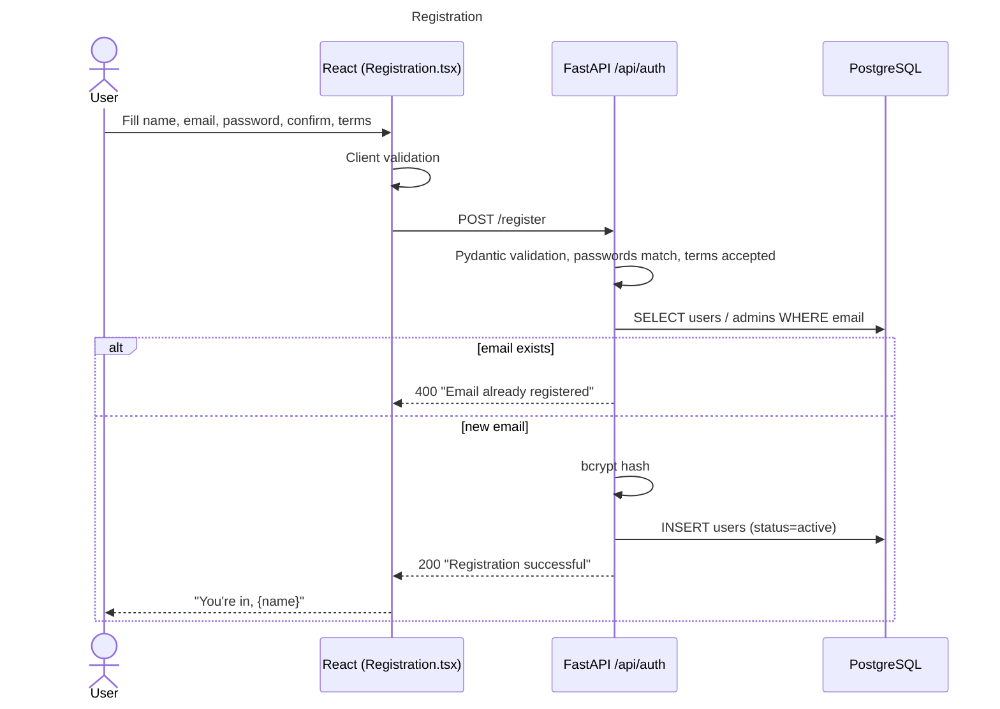
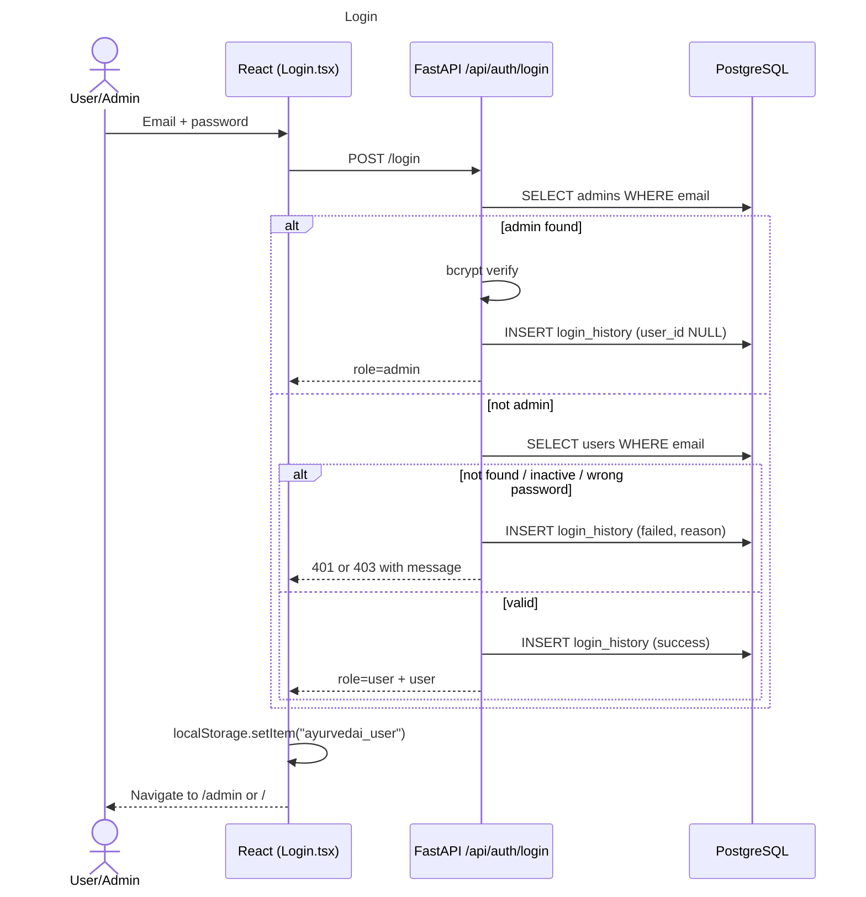
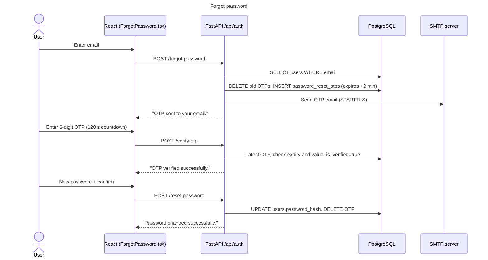
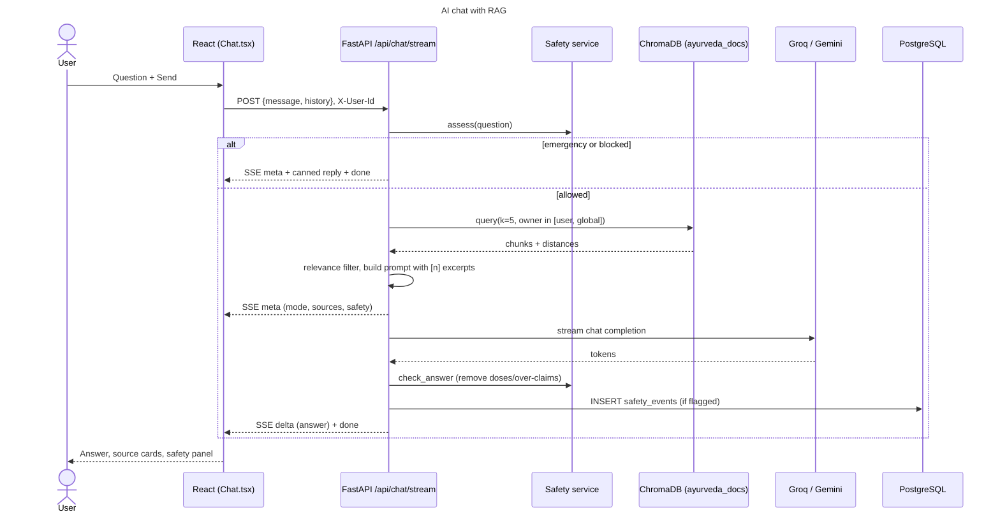
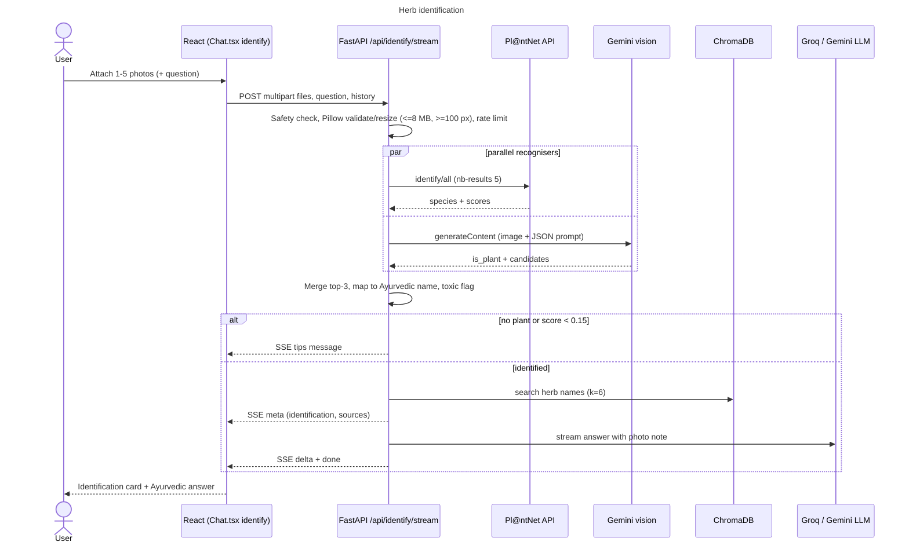
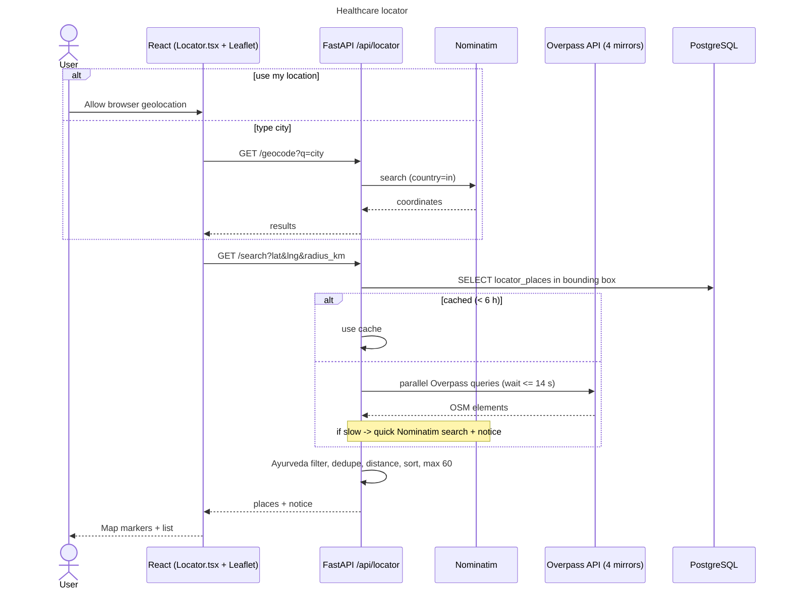
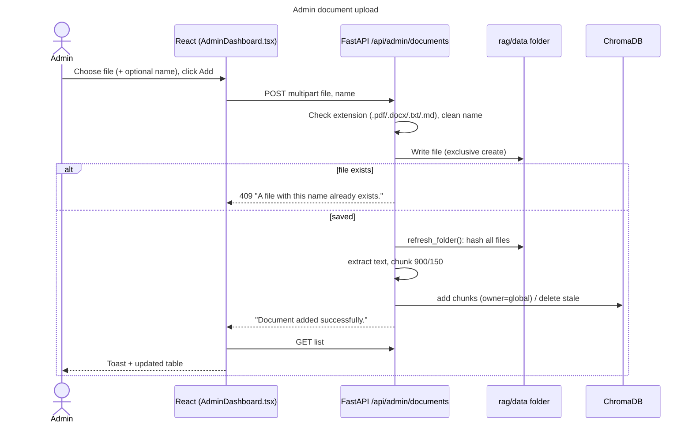
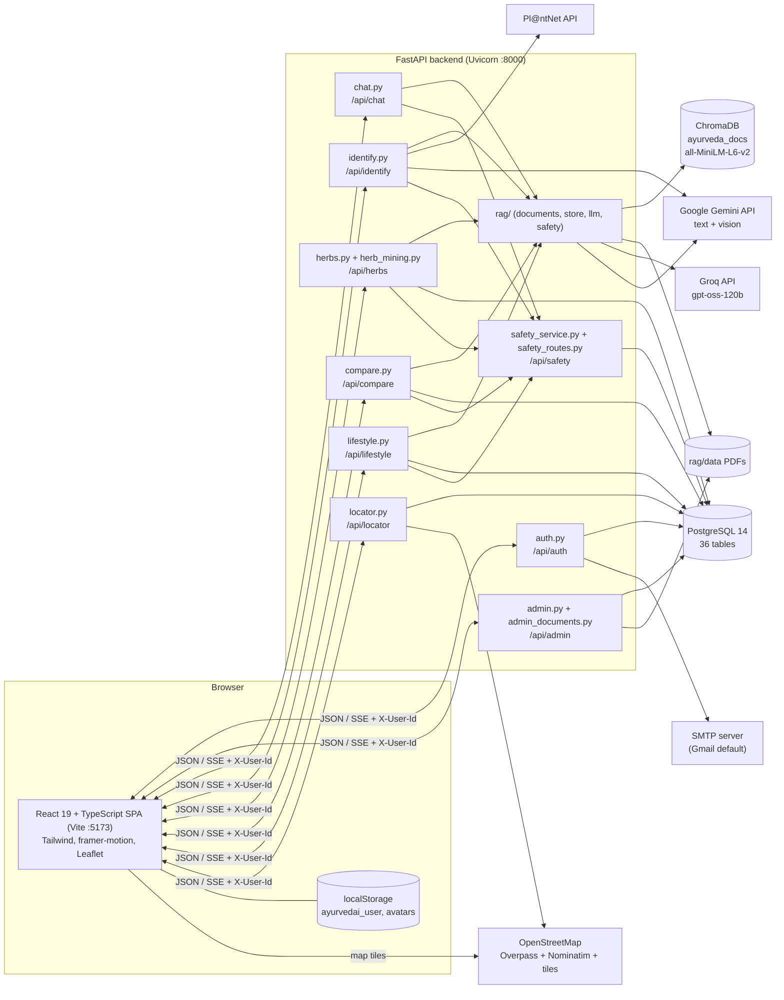

# AyurvedAI – Report Facts (extracted from the codebase)

> Generated read-only from the project at `AyurvedAI/` (this file is the only file created).
> Facts come from source code, the live PostgreSQL schema (read-only queries in a `READ ONLY` transaction), the ChromaDB SQLite file (opened in read-only mode) and `git log`.
> Legend: **DONE** = implemented end-to-end · **PARTIAL** = some parts exist, missing parts stated · **NOT FOUND** = not present in code.
> No secrets are reproduced. For `.env` only variable names are listed.

**Important corrections to the assumed stack (read first):**

| Assumption in brief | What the code actually shows |
|---|---|
| JWT authentication | **NOT FOUND.** No token is issued. Login returns a JSON user object that the frontend stores in `localStorage` (`ayurvedai_user`). See §5. |
| Alembic migrations | **NOT FOUND in repo.** The DB has an `alembic_version` row (`e87c2ab2ff8d`), but no `alembic/` folder or `alembic.ini` exists. Tables used by the current code are created at import time with `Model.__table__.create(bind=engine, checkfirst=True)`. |
| pgvector / `document_chunks` embeddings | **NOT used.** Only the `plpgsql` extension is installed. Embeddings live in **ChromaDB** (`backend/chroma_store/`, collection `ayurveda_docs`). `documents` / `document_chunks` tables exist but are empty and unused. |
| Own trained CNN for herb identification | **NOT FOUND.** Identification uses the external **Pl@ntNet API** + **Google Gemini vision** (see §7). |
| 36 tables all used | Only **20** tables are referenced by current code. **16** tables (`activity_events`, `association_rules`, `chat_messages`, `chat_sessions`, `cms_content`, `conditions`, `diet_lifestyle`, `document_chunks`, `documents`, `facilities`, `formulations`, `herb_identifications`, `herbs`, `references`, `saved_items`, `alembic_version`) exist in the database (some with data) but **no code in this repository reads or writes them**. |

---

## 1. Project overview

### 1.1 Folder tree (3 levels; excludes node_modules, venv, .git, dist, build, \_\_pycache\_\_)

```
AyurvedAI/
├── backend/
│   ├── main.py                    # FastAPI app, CORS, router registration
│   ├── database.py                # SQLAlchemy engine/session/Base
│   ├── models.py                  # users, login_history, admins, password_reset_otps
│   ├── schemas.py                 # Pydantic request schemas for auth
│   ├── auth.py                    # /api/auth (register, login, OTP, reset)
│   ├── email_utils.py             # SMTP OTP email
│   ├── admin.py                   # /api/admin (users, login history)
│   ├── admin_documents.py         # /api/admin/documents (RAG knowledge-base files)
│   ├── create_admin.py            # CLI script to create an admin account
│   ├── chat.py                    # /api/chat (RAG chat, private docs)
│   ├── identify.py                # /api/identify (herb photo identification)
│   ├── locator.py                 # /api/locator (OpenStreetMap healthcare locator)
│   ├── herbs.py                   # /api/herbs (herb & medicine catalog, profiles)
│   ├── herb_mining.py             # FP-Growth association rules (mlxtend)
│   ├── compare.py                 # /api/compare (herb/medicine comparison)
│   ├── lifestyle.py               # /api/lifestyle (prakriti, season, diet plans)
│   ├── ayur_common.py             # shared catalog/safety models + name resolver
│   ├── safety_routes.py           # /api/safety
│   ├── safety_service.py          # rule-based safety engine
│   ├── test_compare.py / test_herbs.py / test_lifestyle.py / test_safety_service.py
│   ├── requirements-chat.txt
│   ├── .env                       # (names only in §12)
│   ├── chroma_store/
│   │   ├── chroma.sqlite3         # ChromaDB persistent store
│   │   └── 47224949-…/            # HNSW index segment
│   ├── rag/
│   │   ├── __init__.py
│   │   ├── documents.py           # text extraction + chunking
│   │   ├── store.py               # ChromaDB wrapper
│   │   ├── llm.py                 # Groq / Gemini streaming clients
│   │   ├── safety.py              # emergency regex + system prompt
│   │   └── data/                  # global knowledge-base PDFs (3 files)
│   └── seed/
│       ├── herbs_seed.json
│       ├── lifestyle_general_guidance.json
│       ├── lifestyle_questions.json
│       ├── lifestyle_seasons.json
│       └── safety_rules.json
├── public/
│   └── favicon.svg
├── src/
│   ├── main.tsx  App.tsx  App.css  index.css
│   ├── Login.tsx  Registration.tsx  ForgotPassword.tsx
│   ├── Home.tsx  AdminDashboard.tsx
│   ├── assets/                    # ayurvedAI_logo.png, herb_scan_img.png, home_hearb_img.png
│   └── components/
│       └── home/                  # all feature pages + landing sections (see §9)
├── index.html  package.json  package-lock.json
├── vite.config.ts  eslint.config.js
├── tsconfig.json  tsconfig.app.json  tsconfig.node.json
├── .gitignore
└── README.md
```

### 1.2 Purpose of folders

| Folder | Purpose |
|---|---|
| `backend/` | Python FastAPI REST + SSE (Server-Sent Events) API; each feature is one router module. |
| `backend/rag/` | Retrieval-Augmented Generation: document reading/chunking (`documents.py`), ChromaDB vector store (`store.py`), LLM clients (`llm.py`), system prompt and emergency rules (`safety.py`). |
| `backend/rag/data/` | Global knowledge base files indexed for all users (managed by Admin → RAG Documents). |
| `backend/chroma_store/` | ChromaDB on-disk persistent vector database (SQLite + HNSW index). Ignored by `.gitignore` but a copy is committed. |
| `backend/seed/` | JSON seed data loaded at server start (herbs/medicines, lifestyle questionnaire, seasons, general guidance, safety rules). |
| `backend/venv/` | Local Python virtual environment (excluded from tree). |
| `public/` | Static files served by Vite (favicon). |
| `src/` | React + TypeScript frontend; top-level pages (Login, Registration, ForgotPassword, Home, AdminDashboard). |
| `src/assets/` | Images (logo, herb scan image, home herb image). |
| `src/components/home/` | Feature pages (Chat shell, HerbsCatalog, ComparePage, LifestylePage, Locator, UserProfile) and landing-page sections. |

### 1.3 Tech stack with versions

Backend `requirements-chat.txt` is **unpinned** and **incomplete** (it lists only 10 packages; SQLAlchemy, psycopg, passlib, bcrypt, Pillow, email-validator, pandas are used but not listed). Versions below are the ones **installed** in `backend/venv` (Python 3.10.12). `pyproject.toml`: NOT FOUND.

| Layer | Library | Version (declared → installed) | Used for |
|---|---|---|---|
| Runtime | Python | 3.10.12 | Backend runtime |
| Backend | fastapi | unpinned → 0.146.0 | REST + SSE API (`main.py`, all routers) |
| Backend | uvicorn | unpinned → 0.54.0 | ASGI server |
| Backend | starlette | (dep) 1.7.0 | CORS middleware, `StreamingResponse` |
| Backend | pydantic | (dep) 2.14.1 | Request validation (`schemas.py`, routers) |
| Backend | email-validator | not listed → 2.3.0 | `EmailStr` in forgot/verify/reset schemas |
| Backend | python-multipart | unpinned → 0.0.32 | File uploads (`UploadFile`, `Form`) |
| Backend | python-dotenv | unpinned → 1.2.4 | Load `backend/.env` |
| Database | SQLAlchemy | not listed → 2.0.55 | ORM (`database.py`, models) |
| Database | psycopg (v3) | not listed → 3.3.6 | PostgreSQL driver (`postgresql+psycopg://`) |
| Database | PostgreSQL server | — → 14.24 | Relational database `ayurvedai` |
| Security | passlib | not listed → 1.7.4 | `CryptContext(schemes=["bcrypt"])` |
| Security | bcrypt | not listed → 4.0.1 | Password hashing backend |
| AI / RAG | chromadb | unpinned → 1.5.9 | Vector store, `DefaultEmbeddingFunction` |
| AI / RAG | onnxruntime | (dep) 1.23.2 | Runs Chroma's all-MiniLM-L6-v2 embedding model locally |
| AI / RAG | httpx | unpinned → 0.28.1 | Calls to Groq, Gemini, Pl@ntNet, Overpass, Nominatim |
| AI / RAG | pypdf | unpinned → 6.21.1 | PDF text extraction |
| AI / RAG | python-docx | unpinned → 1.2.0 | DOCX text extraction |
| Search | rapidfuzz | >=3.9 → 3.14.5 | Fuzzy herb/medicine name matching |
| Data mining | mlxtend | >=0.23.4 → 0.23.4 | FP-Growth + association rules (`herb_mining.py`) |
| Data mining | pandas | not listed → 2.3.3 | One-hot transaction DataFrame for mlxtend |
| Imaging | Pillow | not listed → 12.3.0 | Image validation/resizing (`identify.py`) |
| Frontend | react / react-dom | ^19.2.8 → 19.2.8 | UI |
| Frontend | typescript | ~6.0.2 → 6.0.3 | Type checking |
| Frontend | vite | ^8.2.2 → 8.2.2 | Dev server and build |
| Frontend | @vitejs/plugin-react | ^6.1.0 | React plugin for Vite |
| Frontend | tailwindcss / @tailwindcss/vite | ^4.3.3 → 4.3.3 | Styling (utility classes) |
| Frontend | react-router-dom | ^7.18.3 → 7.18.3 | Client routing (`App.tsx`) |
| Frontend | framer-motion | ^13.4.0 → 13.4.0 | Animations (Home, Chat, Profile) |
| Frontend | lenis | ^1.3.26 → 1.3.26 | Smooth scrolling on Home |
| Frontend | leaflet / @types/leaflet | ^1.9.4 / ^1.9.22 | Interactive map in Healthcare Locator |
| Frontend | react-markdown | ^10.1.0 → 10.1.0 | Declared but **not imported anywhere** (Chat uses its own `RichText` renderer) |
| Dev | eslint | ^10.9.0 → 10.9.1 | Linting |
| Dev | typescript-eslint, eslint-plugin-react-hooks, eslint-plugin-react-refresh, @eslint/js, globals | ^8.67.0, ^7.1.1, ^0.5.4, ^10.0.1, ^17.11.0 | ESLint rule sets |
| External API | Groq (OpenAI-compatible) | default model `openai/gpt-oss-120b` | Primary LLM (`rag/llm.py`) |
| External API | Google Gemini (Generative Language API v1beta) | default `gemini-flash-lite-latest` | Backup LLM + vision herb identification |
| External API | Pl@ntNet API v2 (`/v2/identify/all`) | — | Plant identification from photos |
| External API | OpenStreetMap Overpass API + Nominatim | — | Healthcare locator search + geocoding |
| External | OpenStreetMap tiles (`tile.openstreetmap.org`) | — | Map tiles in Leaflet |
| External | SMTP (default host `smtp.gmail.com`, port 587, STARTTLS) | — | OTP email |

### 1.4 How to run locally (derived from code; README has no instructions)

| Step | Command / note | Evidence |
|---|---|---|
| 1. PostgreSQL | Create database `ayurvedai`; set `DATABASE_URL` in `backend/.env` (`postgresql+psycopg://…`). Tables `users`, `admins`, `login_history`, `password_reset_otps` have **no create call in the repo** and must already exist (Alembic revision `e87c2ab2ff8d` outside repo). All other used tables are auto-created on import. | `database.py`, `models.py`, `ayur_common.py:163-164` |
| 2. Backend deps | `cd backend && python -m venv venv && source venv/bin/activate && pip install -r requirements-chat.txt sqlalchemy "psycopg[binary]" passlib bcrypt pillow email-validator pandas` | requirements + imports |
| 3. Backend env | Fill `backend/.env` (names in §12). | `.env` |
| 4. Create admin | `python create_admin.py` (prompts name, email, password) | `create_admin.py` |
| 5. Run API | `uvicorn main:app --reload --port 8000` (frontend hard-codes `http://127.0.0.1:8000`) | `Login.tsx:118`, `Chat.tsx:34` |
| 6. Frontend | `npm install` then `npm run dev` (Vite, default port 5173 – matches CORS) | `package.json`, `main.py:17` |
| Build | `npm run build` (`tsc -b && vite build`), `npm run lint`, `npm run preview` | `package.json` |
| Tests | `cd backend && python -m unittest` (unittest-style test files) | `test_*.py` |
| Health checks | `GET /db-test`, `/api/chat/health`, `/api/identify/health`, `/api/locator/health`, `/api/safety/health` | routers |

**Docker / deployment config:** NOT FOUND (no Dockerfile, docker-compose, Procfile, vercel/netlify config). A `dist/` build output folder exists locally.

---

## 2. Feature status table

| Feature | Status | Main backend files | Main frontend files | One-line description |
|---|---|---|---|---|
| Registration | DONE | `auth.py` (`/register`), `schemas.py`, `models.py` | `src/Registration.tsx` | Name, email, password, confirm, terms checkbox; bcrypt hash; duplicate check against users **and** admins. |
| Login | DONE | `auth.py` (`/login`) | `src/Login.tsx` | Single login form for both admin and user; role returned in response; every attempt logged. |
| Forgot password + OTP | DONE | `auth.py` (`/forgot-password`, `/verify-otp`, `/reset-password`), `email_utils.py` | `src/ForgotPassword.tsx` | 3-step wizard: email → 6-digit OTP (2 min) → new password. |
| User profile + avatar | PARTIAL | — (no profile API) | `components/home/UserProfile.tsx`, `Avatars.tsx` | Shows name/email/role; 20 illustrated avatars chosen and saved **only in browser localStorage**. No profile edit, no image upload, no change-password, no DB avatar column. |
| Logout | DONE (client-side) | — | `Home.tsx`, `Chat.tsx`, `UserProfile.tsx`, `AdminDashboard.tsx` | Removes `ayurvedai_user` from localStorage and redirects to `/login`; no server call. |
| AI chat (Ask AyurvedAI) | DONE | `chat.py`, `rag/llm.py`, `rag/safety.py` | `components/home/Chat.tsx` (mode `chat`) | Streaming SSE chat; Groq primary, Gemini fallback; multilingual; follow-up history (last 6 msgs). |
| RAG retrieval with sources | DONE | `rag/store.py`, `rag/documents.py`, `chat.py` | `Chat.tsx` (source cards) | ChromaDB cosine search k=5, distance + keyword filter, up to 4 cited sources [1]…[4] with file/page/snippet. |
| Private document upload in chat | DONE | `chat.py` (`/documents`) | `Chat.tsx` (paperclip) | User attaches PDF/DOCX/TXT/MD (≤15 MB); indexed with owner = user key; only that user's chat uses it. |
| Chat history / sessions | PARTIAL | — | `Chat.tsx` (`CACHE`, sidebar list) | Multiple sessions in sidebar but kept **only in browser memory** (lost on refresh). DB tables `chat_sessions`/`chat_messages` exist but are never written by code. |
| Herb image identification | DONE (external APIs) | `identify.py` | `Chat.tsx` (mode `identify`, `IdentCard`) | Up to 5 photos → Pl@ntNet + Gemini vision in parallel → merged top-3 → Ayurvedic answer streamed. Nothing saved to `herb_identifications`. |
| Herb information | DONE | `herbs.py`, `ayur_common.py`, `seed/herbs_seed.json` | `components/home/HerbsCatalog.tsx` | 101 herbs (`ayur_herbs`); search, A–Z browse, detail profile extracted by LLM from documents, related herbs, combos. |
| Medicine information | DONE | `herbs.py` (`/medicines`) | `HerbsCatalog.tsx` (Medicines tab) | 16 classical formulations in `ayur_medicines` with form, ingredients, sourced summary. |
| Formulations | PARTIAL | `herbs.py` (as "medicines") | `HerbsCatalog.tsx` | Formulations are served from `ayur_medicines`. The separate `formulations` table (31 rows) is **not used** by any code. |
| Conditions / diseases | NOT FOUND | — | — | `conditions` table holds 16 rows, but no API or page uses it. |
| Herb / medicine comparison | DONE | `compare.py`, `herbs.py` (`build_profile`) | `ComparePage.tsx`, `CompareTable.tsx` | Compare 2–4 herbs **or** 2–4 medicines; property table with same/different flags, similarity matrix, AI summary, print/copy. |
| Diet & lifestyle – prakriti questionnaire | DONE | `lifestyle.py` (`/questions`, `/prakriti`) | `LifestylePage.tsx` (Constitution tab) | 10 questions, weighted Vata/Pitta/Kapha percentages, dominant dosha(s). |
| Diet & lifestyle – seasons (Ritucharya) | DONE | `lifestyle.py` (`/season`) | `LifestylePage.tsx` (Seasonal guide tab) | 6 Indian seasons by month; season notes extracted from documents and cached per user. |
| Diet & lifestyle – plans & routines | DONE | `lifestyle.py` (`/plan`, `/plans`) | `LifestylePage.tsx` (Diet, Daily routine tabs) | Food favour/limit lists + daily routine; diet tags, avoid list, safety blocking; save plan; print as PDF. |
| Daily tip | DONE | `lifestyle.py` (`/tip`) | `components/home/LifestyleTip.tsx` | Rotating sourced food tip of the day on Home. |
| Food rules | DONE | `lifestyle.py` (`FoodRule`) | `LifestylePage.tsx` | `food_rules` rows (6 shared WHO-sourced rows + per-user LLM-extracted rows). |
| Food incompatibilities (Viruddha Ahara) | PARTIAL | `lifestyle.py` (`FoodIncompatibility`, `_select_plan`) | `LifestylePage.tsx` ("Food-combination notes") | Logic removes both foods of an incompatible pair from a plan, but table is empty (0 rows) and there is no API/UI to add pairs. |
| Association rules | PARTIAL | `herb_mining.py`, `herbs.py` (`/admin/mining/run`, `/{slug}/combos`) | `HerbsCatalog.tsx` (combos section) | FP-Growth over approved formulation ingredients; needs ≥20 **approved** medicines – DB has 16 **draft** → always "Not enough data yet". Table `association_rules` unused (code uses `ayur_herb_rules`, 0 rows). |
| Healthcare locator | DONE | `locator.py` | `components/home/Locator.tsx` | Ayurvedic hospitals/clinics/doctors/pharmacies from OpenStreetMap within 5/10/25/50 km, Leaflet map, verified places table. |
| Saved items | NOT FOUND | — | — | `saved_items` table exists (0 rows); no code. (Saved **lifestyle plans** do exist – see above.) |
| Safety warnings / safety events | DONE | `safety_service.py`, `safety_routes.py`, `rag/safety.py`, `seed/safety_rules.json` | `Chat.tsx` (`SafetyConsent`, `SafetyPanel`), all feature pages | Emergency detection, special-group warnings, personal-dose blocking, output dose/overclaim filter, `safety_events` logging with hashed user. |
| Activity tracking | NOT FOUND | — | — | `activity_events` table exists (0 rows); no code. |
| CMS content | NOT FOUND | — | — | `cms_content` table exists (0 rows); no code. Landing-page text is hard-coded in React. |
| Admin dashboard | DONE | `admin.py`, `admin_documents.py` | `src/AdminDashboard.tsx` | 4 stat cards (total/active/inactive users, total documents). |
| Admin users | DONE | `admin.py` | `AdminDashboard.tsx` (Users) | List, search, paginate (10), toggle active/inactive, delete with confirm. |
| Admin login history | DONE | `admin.py` | `AdminDashboard.tsx` (Login History) | List, search, paginate (10); shows IP, status, failure reason. |
| Admin documents (RAG) | DONE | `admin_documents.py`, `rag/store.py` | `AdminDashboard.tsx` (RAG Documents) | Upload (optional rename), list, search, paginate (5), rename, delete; ChromaDB re-synced after each change. |
| Other admin functions (API only) | PARTIAL | `herbs.py`, `safety_routes.py`, `locator.py`, `lifestyle.py` | — (no UI) | Header-key protected endpoints: herb upsert/approve/rebuild/import (JSON/CSV), run association mining, edit safety rules, view safety events, retention cleanup, add/delete verified locator places, approve/reject lifestyle rules. The required keys `SAFETY_ADMIN_KEY` / `LOCATOR_ADMIN_KEY` are **not set** in `.env`, so these return 503/403 now. |
| Report / export | PARTIAL | — | `ComparePage.tsx` (Print, Copy text), `LifestylePage.tsx` ("Save plan as PDF" via `window.print()` with print stylesheet) | Browser print only. No server-side PDF, no CSV export. Admin export: NOT FOUND. |

---

## 3. Database – full data dictionary

**Source of truth:** live PostgreSQL 14.24 database `ayurvedai` (schema `public`, 36 tables) read via `information_schema` / `pg_constraint` / `pg_indexes`, cross-checked with SQLAlchemy models.
**General notes**
- **No CHECK constraints** exist in the database. Allowed values listed below are enforced in Python (Pydantic `Literal`, `if` checks) – marked "app-enforced".
- "app default" = SQLAlchemy Python-side default (not stored in the DB schema). "DB default" = `DEFAULT` in PostgreSQL.
- All JSON columns are PostgreSQL **`json`** (not `jsonb`). No `vector` columns exist.
- Every `integer`/`bigint` primary key uses a sequence: `DEFAULT nextval('<table>_id_seq')`.
- Tables marked **"(unused by code)"** were created outside this repository (Alembic revision `e87c2ab2ff8d`); column descriptions for them are inferred from column names and data.

### 3.1 activity_events (unused by code, 0 rows)
Intended to log user activity (event type, item, session). No module in this repository writes or reads it; "Activity tracking" feature is NOT FOUND.

| Sr. No. | Field Name | Data Type | Size | Key / Constraint | Description |
|---|---|---|---|---|---|
| 1 | id | integer | — | Primary key, not null, DB default nextval, index `ix_activity_events_id` | Unique event identifier. |
| 2 | user_id | bigint | — | Foreign key → users.id ON DELETE SET NULL, nullable | User who performed the action. |
| 3 | event_type | varchar | 50 | Not null | Kind of activity (e.g. view, search) – inferred. |
| 4 | item_type | varchar | 50 | Nullable | Type of item the event refers to – inferred. |
| 5 | item_id | integer | — | Nullable | ID of the referenced item – inferred. |
| 6 | session_id | varchar | 100 | Nullable | Client/session identifier – inferred. |
| 7 | created_at | timestamp without time zone | — | DB default now() | Time the event was recorded. |

### 3.2 admins (1 row) – `backend/models.py` (`Admin`)
Stores administrator accounts. Used by Login (admin branch), Registration (prevents a user registering with an admin's email) and `create_admin.py`.

| Sr. No. | Field Name | Data Type | Size | Key / Constraint | Description |
|---|---|---|---|---|---|
| 1 | id | bigint | — | Primary key, not null, index `ix_admins_id` | Unique admin identifier. |
| 2 | name | varchar | 50 | Not null | Admin display name. |
| 3 | email | varchar | 50 | Not null, unique (unique index `ix_admins_email`) | Admin login email (stored lower-case by `create_admin.py`). |
| 4 | password_hash | varchar | 255 | Not null | bcrypt hash of the admin password. |
| 5 | created_at | timestamp without time zone | — | Not null, DB default CURRENT_TIMESTAMP | Account creation time. |
| 6 | updated_at | timestamp without time zone | — | Not null, DB default CURRENT_TIMESTAMP | Last update time (never changed by code). |

### 3.3 alembic_version (1 row)
Alembic bookkeeping table; holds the current migration revision `e87c2ab2ff8d`. The Alembic environment itself is NOT FOUND in the repository.

| Sr. No. | Field Name | Data Type | Size | Key / Constraint | Description |
|---|---|---|---|---|---|
| 1 | version_num | varchar | 32 | Primary key (`alembic_version_pkc`), not null | Current Alembic revision identifier. |

### 3.4 association_rules (unused by code, 0 rows)
Intended store for mined association rules. Current code writes rules to `ayur_herb_rules` instead.

| Sr. No. | Field Name | Data Type | Size | Key / Constraint | Description |
|---|---|---|---|---|---|
| 1 | id | integer | — | Primary key, index `ix_association_rules_id` | Unique rule identifier. |
| 2 | antecedents | json | — | Not null | Left-hand item set of the rule. |
| 3 | consequents | json | — | Not null | Right-hand item set of the rule. |
| 4 | support | double precision | — | Not null | Fraction of transactions containing both sets. |
| 5 | confidence | double precision | — | Not null | Conditional probability of consequents given antecedents. |
| 6 | lift | double precision | — | Not null | Confidence divided by consequent support. |
| 7 | rule_type | varchar | 50 | Nullable | Category of rule – inferred. |
| 8 | generated_at | timestamp without time zone | — | DB default now() | Time the rule was generated. |

### 3.5 ayur_comparison_cache (13 rows) – `backend/compare.py` (`ComparisonCache`)
Caches complete comparison responses per user so repeating the same comparison is instant. Used by Compare (`POST /api/compare`, `/summary`).

| Sr. No. | Field Name | Data Type | Size | Key / Constraint | Description |
|---|---|---|---|---|---|
| 1 | id | integer | — | Primary key, index | Unique cache row identifier. |
| 2 | owner_hash | varchar | 64 | Not null, index; unique together with cache_key (`uq_ayur_comparison_owner_key`) | SHA-256 hex of the user key (X-User-Id). |
| 3 | cache_key | varchar | 64 | Not null, index; part of composite unique key | SHA-256 of kind + sorted slugs + profile hash. |
| 4 | kind | varchar | 20 | Not null; app-enforced values: `herb`, `medicine` | Type of items compared. |
| 5 | sorted_slugs | json | — | Not null | Alphabetically sorted list of compared item slugs. |
| 6 | profile_hash | varchar | 64 | Not null | Hash of item profiles; cache invalidates when profiles change. |
| 7 | response | json | — | Not null | Full comparison response (items, rows, similarity, references). |
| 8 | created_at | timestamp with time zone | — | Not null, DB default now() | Time the cache row was created. |

### 3.6 ayur_herb_profile_cache (27 rows) – `backend/herbs.py` (`HerbProfileCache`)
Stores the LLM-extracted, source-cited herb profile per user (owner) and herb, so the AI extraction only re-runs when the matching document chunks change. Used by herb detail, search cards, browse, related herbs and compare.

| Sr. No. | Field Name | Data Type | Size | Key / Constraint | Description |
|---|---|---|---|---|---|
| 1 | id | integer | — | Primary key, index | Unique cache row identifier. |
| 2 | owner_hash | varchar | 64 | Not null, index; unique with herb_slug (`uq_herb_profile_owner_slug`) | SHA-256 hex of the user key. |
| 3 | herb_slug | varchar | 120 | Not null, index; part of composite unique key; logical link → ayur_herbs.slug | Herb this profile belongs to. |
| 4 | chunk_hash | varchar | 64 | Not null | Hash of extraction version + source chunk IDs used. |
| 5 | profile | json | — | Not null, app default {} | Validated profile (rasa, guna, virya, vipaka, prabhava, dosha_effect, parts_used, classical_uses, forms, precautions, contraindications, interactions, traditional_dose_note, habitat, references, origins). |
| 6 | source_ids | json | — | Not null, app default [] | Chroma chunk IDs that support the profile. |
| 7 | status | varchar | 20 | Not null, app default `draft` | Review status (always `draft` when generated). |
| 8 | updated_at | timestamp with time zone | — | Not null, DB default now(), ORM onupdate now() | Last refresh time. |

### 3.7 ayur_herb_rules (0 rows) – `backend/herb_mining.py` (`AyurHerbRule`)
Association rules mined with FP-Growth from ingredients of approved formulations; read by `GET /api/herbs/{slug}/combos`.

| Sr. No. | Field Name | Data Type | Size | Key / Constraint | Description |
|---|---|---|---|---|---|
| 1 | id | integer | — | Primary key, index | Unique rule identifier. |
| 2 | antecedent | json | — | Not null | Sorted list of ingredient names on the left side. |
| 3 | consequent | json | — | Not null | Sorted list of ingredient names on the right side. |
| 4 | support | double precision | — | Not null | Rule support (min 0.05 by default). |
| 5 | confidence | double precision | — | Not null | Rule confidence (min 0.6 by default). |
| 6 | lift | double precision | — | Not null | Rule lift. |
| 7 | n_transactions | integer | — | Not null | Number of formulations used in mining. |
| 8 | created_at | timestamp with time zone | — | Not null, DB default now() | Mining time. |

### 3.8 ayur_herb_safety (0 rows) – `backend/ayur_common.py` (`AyurHerbSafety`)
Curated herb safety notes (e.g. drug interactions). Only rows with `status='published'` are shown on herb detail and by `GET /api/safety/herb/{slug}`.

| Sr. No. | Field Name | Data Type | Size | Key / Constraint | Description |
|---|---|---|---|---|---|
| 1 | id | integer | — | Primary key, index | Unique safety note identifier. |
| 2 | herb_slug | varchar | 120 | Not null, index; logical link → ayur_herbs.slug (no FK) | Herb the note applies to. |
| 3 | category | varchar | 40 | Not null | Safety category (e.g. interaction, pregnancy). |
| 4 | drug_class | varchar | 80 | Nullable | Interacting drug class, if any. |
| 5 | severity | varchar | 20 | Not null, app default `info` | Severity level. |
| 6 | note | text | — | Not null, app default '' | Safety note text. |
| 7 | source_id | integer | — | Nullable; logical link → ayur_sources.id (no FK) | Supporting source. |
| 8 | status | varchar | 20 | Not null, app default `draft`; displayed only when `published` | Review status. |
| 9 | created_at | timestamp with time zone | — | Not null, DB default now() | Creation time. |

### 3.9 ayur_herbs (101 rows) – `backend/ayur_common.py` (`AyurHerb`)
Master herb catalog used by Herbs & Medicines, Compare, name resolution and the Lifestyle "no herbs in diet plan" filter. Seeded from `seed/herbs_seed.json` (100 herbs) on startup.

| Sr. No. | Field Name | Data Type | Size | Key / Constraint | Description |
|---|---|---|---|---|---|
| 1 | id | integer | — | Primary key, index | Unique herb identifier. |
| 2 | slug | varchar | 120 | Not null, unique (`uq_ayur_herbs_slug` + unique index `ix_ayur_herbs_slug`) | URL-safe herb key (e.g. `ashwagandha`). |
| 3 | name_english | varchar | 200 | Nullable | English/common name. |
| 4 | name_sanskrit | varchar | 200 | Nullable | Sanskrit name. |
| 5 | name_hindi | varchar | 200 | Nullable | Hindi name. |
| 6 | name_gujarati | varchar | 200 | Nullable | Gujarati name. |
| 7 | botanical_name | varchar | 200 | Nullable | Latin botanical name. |
| 8 | family | varchar | 120 | Nullable | Botanical family. |
| 9 | aliases | json | — | Nullable, app default [] | Alternative names used for search. |
| 10 | profile | json | — | Nullable, app default {} | Seed/global profile (same structure as profile cache). |
| 11 | source_ids | json | — | Nullable, app default [] | IDs/document IDs in ayur_sources. |
| 12 | status | varchar | 20 | Not null, app default `draft`; values used `draft`, `approved` | Review status (all 101 are `draft`). |
| 13 | toxic | varchar | 20 | Nullable, app default `'false'` | `'true'`/`'false'` stored as text. |
| 14 | created_at | timestamp with time zone | — | Not null, DB default now() | Creation time. |
| 15 | updated_at | timestamp with time zone | — | Not null, DB default now(), ORM onupdate | Last update time. |

### 3.10 ayur_medicines (16 rows) – `backend/ayur_common.py` (`AyurMedicine`)
Classical Ayurvedic formulations ("medicines") shown in the Medicines tab and Compare; ingredients are the transactions for association mining.

| Sr. No. | Field Name | Data Type | Size | Key / Constraint | Description |
|---|---|---|---|---|---|
| 1 | id | integer | — | Primary key, index | Unique medicine identifier. |
| 2 | slug | varchar | 120 | Not null, unique (`uq_ayur_medicines_slug` + unique index) | URL-safe key. |
| 3 | name | varchar | 200 | Not null | Medicine name (e.g. Triphala). |
| 4 | aliases | json | — | Nullable, app default [] | Alternative names. |
| 5 | form | varchar | 50 | Not null, app default `other`; data values: churna, kwatha, arishta, ghrita, taila, rasayana, guggulu | Dosage form. |
| 6 | ingredients | json | — | Nullable, app default [] | List of ingredient herb names. |
| 7 | profile | json | — | Nullable, app default {} | Profile incl. sourced `summary`. |
| 8 | source_ids | json | — | Nullable, app default [] (import requires ≥1) | Supporting source IDs / document IDs. |
| 9 | status | varchar | 20 | Not null, app default `draft` | Review status (mining uses only `approved`). |
| 10 | created_at | timestamp with time zone | — | Not null, DB default now() | Creation time. |
| 11 | updated_at | timestamp with time zone | — | Not null, DB default now(), ORM onupdate | Last update time. |

### 3.11 ayur_sources (17 rows) – `backend/ayur_common.py` (`AyurSource`)
Bibliographic sources cited by herbs/medicines (local PDF pages, documents).

| Sr. No. | Field Name | Data Type | Size | Key / Constraint | Description |
|---|---|---|---|---|---|
| 1 | id | integer | — | Primary key, index | Unique source identifier. |
| 2 | title | varchar | 255 | Not null | Source title (e.g. "AyurvedAI Knowledge Sheet v1.0"). |
| 3 | kind | varchar | 50 | Not null, app default `other` (data: `document`) | Source type. |
| 4 | url | varchar | 500 | Nullable | Link to the source. |
| 5 | document_id | varchar | 120 | Nullable | Stable document key (e.g. `AYU-009`, `ayurvedai-topics-p9`). |
| 6 | license | varchar | 120 | Nullable | Licence of the source. |
| 7 | note | text | — | Nullable | Page/notes (e.g. "Page 1 · Glossary …"). |
| 8 | created_at | timestamp with time zone | — | Not null, DB default now() | Creation time. |

### 3.12 chat_messages (unused by code, 12 rows)
Intended to store each chat message. Current chat keeps messages only in browser memory.

| Sr. No. | Field Name | Data Type | Size | Key / Constraint | Description |
|---|---|---|---|---|---|
| 1 | id | integer | — | Primary key, index | Unique message identifier. |
| 2 | session_id | integer | — | Not null, foreign key → chat_sessions.id ON DELETE CASCADE | Chat session the message belongs to. |
| 3 | role | varchar | 20 | Not null (data: `user`, `assistant`) | Who wrote the message. |
| 4 | content | text | — | Not null | Message text. |
| 5 | sources | json | — | Nullable | Cited sources for assistant replies – inferred. |
| 6 | created_at | timestamp without time zone | — | DB default now() | Time sent. |

### 3.13 chat_sessions (unused by code, 3 rows)
Intended chat conversation headers per user.

| Sr. No. | Field Name | Data Type | Size | Key / Constraint | Description |
|---|---|---|---|---|---|
| 1 | id | integer | — | Primary key, index | Unique session identifier. |
| 2 | user_id | bigint | — | Not null, foreign key → users.id ON DELETE CASCADE | Owner of the conversation. |
| 3 | title | varchar | 500 | Nullable | Conversation title. |
| 4 | created_at | timestamp without time zone | — | DB default now() | Creation time. |
| 5 | updated_at | timestamp without time zone | — | DB default now() | Last activity time. |

### 3.14 cms_content (unused by code, 0 rows)
Intended key–value store for editable site content. CMS feature NOT FOUND.

| Sr. No. | Field Name | Data Type | Size | Key / Constraint | Description |
|---|---|---|---|---|---|
| 1 | id | integer | — | Primary key, index | Unique content identifier. |
| 2 | key | varchar | 100 | Not null, unique (unique index `ix_cms_content_key`) | Content slot key. |
| 3 | title | varchar | 300 | Nullable | Content title. |
| 4 | content | text | — | Nullable | Content body. |
| 5 | updated_at | timestamp without time zone | — | DB default now() | Last edit time. |

### 3.15 conditions (unused by code, 16 rows)
Disease/condition reference data (e.g. "Diabetes Mellitus (Prameha)"). No API or UI uses it.

| Sr. No. | Field Name | Data Type | Size | Key / Constraint | Description |
|---|---|---|---|---|---|
| 1 | id | integer | — | Primary key, index | Unique condition identifier. |
| 2 | name | varchar | 300 | Not null, index `ix_conditions_name` | Condition name (modern + Ayurvedic). |
| 3 | ayurvedic_name | varchar | 300 | Nullable | Ayurvedic term. |
| 4 | description | text | — | Nullable | Description. |
| 5 | symptoms | json | — | Nullable | List of symptoms. |
| 6 | related_herb_ids | json | — | Nullable; logical → herbs.id | Related herbs. |
| 7 | diet_ids | json | — | Nullable; logical → diet_lifestyle.id | Related diet items. |
| 8 | lifestyle_ids | json | — | Nullable; logical → diet_lifestyle.id | Related lifestyle items. |
| 9 | precautions | text | — | Nullable | Precautions. |
| 10 | source_ref_ids | json | — | Nullable; logical → references.id | Supporting references. |
| 11 | needs_expert_review | boolean | — | Nullable | Flag for expert review. |
| 12 | is_published | boolean | — | Nullable | Visibility flag. |
| 13 | created_at | timestamp without time zone | — | DB default now() | Creation time. |
| 14 | updated_at | timestamp without time zone | — | DB default now() | Last update time. |

### 3.16 diet_lifestyle (unused by code, 17 rows)
Diet / dinacharya / lifestyle reference entries (categories in data: `diet` 10, `dinacharya` 4, `lifestyle` 3). Current Lifestyle module uses `food_rules` and `routine_items` instead.

| Sr. No. | Field Name | Data Type | Size | Key / Constraint | Description |
|---|---|---|---|---|---|
| 1 | id | integer | — | Primary key, index | Unique entry identifier. |
| 2 | category | varchar | 50 | Not null | Category (diet / dinacharya / lifestyle). |
| 3 | title | varchar | 300 | Not null, index `ix_diet_lifestyle_title` | Entry title. |
| 4 | content | text | — | Nullable | Entry body. |
| 5 | dosha | varchar | 50 | Nullable | Target dosha. |
| 6 | season | varchar | 100 | Nullable | Applicable season. |
| 7 | source_ref_ids | json | — | Nullable; logical → references.id | Supporting references. |
| 8 | is_published | boolean | — | Nullable | Visibility flag. |
| 9 | created_at | timestamp without time zone | — | DB default now() | Creation time. |
| 10 | updated_at | timestamp without time zone | — | DB default now() | Last update time. |

### 3.17 document_chunks (unused by code, 0 rows)
Intended text chunks of uploaded documents with a pointer to a Chroma ID. **No embedding column** – vectors are only in ChromaDB.

| Sr. No. | Field Name | Data Type | Size | Key / Constraint | Description |
|---|---|---|---|---|---|
| 1 | id | integer | — | Primary key, index | Unique chunk identifier. |
| 2 | document_id | integer | — | Not null, foreign key → documents.id ON DELETE CASCADE | Parent document. |
| 3 | chunk_index | integer | — | Not null | Position of the chunk within the document. |
| 4 | text | text | — | Not null | Chunk text. |
| 5 | chroma_id | varchar | 200 | Nullable | ID of the matching vector in ChromaDB. |

### 3.18 documents (unused by code, 0 rows)
Intended registry of knowledge-base documents. Current admin document feature uses the `rag/data/` folder and ChromaDB metadata instead.

| Sr. No. | Field Name | Data Type | Size | Key / Constraint | Description |
|---|---|---|---|---|---|
| 1 | id | integer | — | Primary key, index | Unique document identifier. |
| 2 | title | varchar | 500 | Not null | Document title. |
| 3 | source_ref_id | integer | — | Nullable, foreign key → references.id ON DELETE SET NULL | Bibliographic reference. |
| 4 | raw_text | text | — | Nullable | Extracted full text. |
| 5 | status | varchar | 30 | Nullable | Ingestion status – inferred. |
| 6 | ingested_at | timestamp without time zone | — | Nullable | Time the document was indexed. |
| 7 | created_at | timestamp without time zone | — | DB default now() | Upload time. |

### 3.19 facilities (unused by code, 0 rows)
Intended healthcare facility directory. Current locator uses OpenStreetMap + `locator_places`.

| Sr. No. | Field Name | Data Type | Size | Key / Constraint | Description |
|---|---|---|---|---|---|
| 1 | id | integer | — | Primary key, index | Unique facility identifier. |
| 2 | name | varchar | 300 | Not null | Facility name. |
| 3 | type | varchar | 50 | Not null | Facility type (hospital, clinic…). |
| 4 | address | text | — | Nullable | Street address. |
| 5 | city | varchar | 100 | Nullable | City. |
| 6 | state | varchar | 100 | Nullable | State. |
| 7 | lat | double precision | — | Nullable | Latitude. |
| 8 | lng | double precision | — | Nullable | Longitude. |
| 9 | phone | varchar | 50 | Nullable | Phone number. |
| 10 | website | varchar | 500 | Nullable | Website URL. |
| 11 | source | varchar | 20 | Nullable | Data origin – inferred. |
| 12 | verified | boolean | — | Nullable | Verified flag. |
| 13 | is_active | boolean | — | Nullable | Active flag. |
| 14 | created_at | timestamp without time zone | — | DB default now() | Creation time. |
| 15 | updated_at | timestamp without time zone | — | DB default now() | Last update time. |

### 3.20 food_incompatibilities (0 rows) – `backend/lifestyle.py` (`FoodIncompatibility`)
Incompatible food pairs (Viruddha Ahara). When both foods would appear in a plan, both are removed and the reason shown.

| Sr. No. | Field Name | Data Type | Size | Key / Constraint | Description |
|---|---|---|---|---|---|
| 1 | id | integer | — | Primary key | Unique pair identifier. |
| 2 | food_a | varchar | 200 | Not null | First food of the pair. |
| 3 | food_b | varchar | 200 | Not null | Second food of the pair. |
| 4 | reason | text | — | Not null | Why the combination is avoided. |
| 5 | source_ids | json | — | Not null, app default [] | Citations. |
| 6 | status | varchar | 20 | Not null, app default `draft`; app values `draft`, `approved`, `rejected` | Review status. |
| 7 | owner_hash | varchar | 64 | Nullable, index `ix_food_incompatibilities_owner_hash` | NULL = shared row; else per-user row. |

### 3.21 food_rules (6 rows) – `backend/lifestyle.py` (`FoodRule`)
Food guidance items ("favour"/"limit") for diet plans. 6 shared rows are seeded from WHO public-health guidance; per-user rows are extracted by the LLM from the user's documents.

| Sr. No. | Field Name | Data Type | Size | Key / Constraint | Description |
|---|---|---|---|---|---|
| 1 | id | integer | — | Primary key | Unique rule identifier. |
| 2 | food | varchar | 200 | Not null | Food name. |
| 3 | category | varchar | 30 | Not null; app values `favour`, `limit` | Whether to favour or limit. |
| 4 | rasa | json | — | Not null, app default [] | Tastes (rasa). |
| 5 | virya | varchar | 80 | Nullable | Potency (hot/cold). |
| 6 | dosha_effect | json | — | Not null, app default {}; values −1…1 per dosha | Effect on vata/pitta/kapha. |
| 7 | season_notes | json | — | Not null, app default {}; keys = 6 season names | Season-specific notes. |
| 8 | diet_tags | json | — | Not null, app default []; app values vegetarian, veg, vegan, jain, egg, dairy, gluten | Diet compatibility tags. |
| 9 | caution_note | text | — | Nullable | Caution text. |
| 10 | description | text | — | Not null, app default '' | Guidance text. |
| 11 | source_ids | json | — | Not null, app default [] | Citation objects (title, url/page, snippet, kind, trust). |
| 12 | status | varchar | 20 | Not null, app default `draft`; values `draft`, `approved`, `rejected` | Review status. |
| 13 | owner_hash | varchar | 64 | Nullable, index `ix_food_rules_owner_hash` | NULL = shared row; else SHA-256 of user key. |

### 3.22 formulations (unused by code, 31 rows)
Formulation reference data (e.g. Triphala Churna, Chyawanprash). Not used; the app serves formulations from `ayur_medicines`.

| Sr. No. | Field Name | Data Type | Size | Key / Constraint | Description |
|---|---|---|---|---|---|
| 1 | id | integer | — | Primary key, index | Unique formulation identifier. |
| 2 | name | varchar | 300 | Not null, index `ix_formulations_name` | Formulation name. |
| 3 | type | varchar | 100 | Nullable (data: churna, tablet, kwatha, ghrita, asava, arishta, avaleha, bhasma, capsule, rasayana, taila) | Formulation type. |
| 4 | ingredient_herb_ids | json | — | Nullable; logical → herbs.id | Ingredient herbs. |
| 5 | ingredients_text | text | — | Nullable | Ingredient description. |
| 6 | indications_text | text | — | Nullable | Traditional indications. |
| 7 | dosage_form | varchar | 200 | Nullable | Dosage form. |
| 8 | preparation | text | — | Nullable | Preparation method. |
| 9 | precautions | text | — | Nullable | Precautions. |
| 10 | classical_reference | varchar | 500 | Nullable | Classical text reference. |
| 11 | source_ref_ids | json | — | Nullable; logical → references.id | Supporting references. |
| 12 | needs_expert_review | boolean | — | Nullable | Flag for expert review. |
| 13 | is_published | boolean | — | Nullable | Visibility flag. |
| 14 | created_at | timestamp without time zone | — | DB default now() | Creation time. |
| 15 | updated_at | timestamp without time zone | — | DB default now() | Last update time. |

### 3.23 herb_identifications (unused by code, 0 rows)
Intended history of photo identifications. Current `identify.py` processes photos in memory and **does not save** anything.

| Sr. No. | Field Name | Data Type | Size | Key / Constraint | Description |
|---|---|---|---|---|---|
| 1 | id | integer | — | Primary key, index | Unique identification record. |
| 2 | user_id | bigint | — | Not null, foreign key → users.id ON DELETE CASCADE | User who uploaded the photo. |
| 3 | image_path | varchar | 500 | Nullable | Stored image path. |
| 4 | top_predictions | json | — | Nullable | Top predicted species with scores. |
| 5 | chosen_herb_id | integer | — | Nullable, foreign key → herbs.id ON DELETE SET NULL | Herb confirmed by the user. |
| 6 | source | varchar | 50 | Nullable | Recogniser used – inferred. |
| 7 | created_at | timestamp without time zone | — | DB default now() | Time of identification. |

### 3.24 herbs (unused by code, 63 rows)
Older/alternative herb table (63 herbs, all `is_published`). Current app uses `ayur_herbs`.

| Sr. No. | Field Name | Data Type | Size | Key / Constraint | Description |
|---|---|---|---|---|---|
| 1 | id | integer | — | Primary key, index | Unique herb identifier. |
| 2 | name_en | varchar | 200 | Not null, index `ix_herbs_name_en` | English name. |
| 3 | name_sanskrit | varchar | 200 | Nullable | Sanskrit name. |
| 4 | name_hindi | varchar | 200 | Nullable | Hindi name. |
| 5 | name_gujarati | varchar | 200 | Nullable | Gujarati name. |
| 6 | botanical_name | varchar | 300 | Nullable | Botanical name. |
| 7 | family | varchar | 200 | Nullable | Botanical family. |
| 8 | description | text | — | Nullable | Description. |
| 9 | parts_used | json | — | Nullable | Plant parts used. |
| 10 | rasa | json | — | Nullable | Tastes. |
| 11 | guna | json | — | Nullable | Qualities. |
| 12 | virya | varchar | 100 | Nullable | Potency. |
| 13 | vipaka | varchar | 100 | Nullable | Post-digestive effect. |
| 14 | dosha_effect | json | — | Nullable | Effect on doshas. |
| 15 | uses | json | — | Nullable | Traditional uses. |
| 16 | precautions | text | — | Nullable | Precautions. |
| 17 | contraindications | text | — | Nullable | Contraindications. |
| 18 | interactions | text | — | Nullable | Drug interactions. |
| 19 | image_url | varchar | 500 | Nullable | Image link. |
| 20 | source_ref_ids | json | — | Nullable; logical → references.id | Supporting references. |
| 21 | needs_expert_review | boolean | — | Nullable | Review flag (14 rows true). |
| 22 | is_published | boolean | — | Nullable | Visibility flag (63 rows true). |
| 23 | created_at | timestamp without time zone | — | DB default now() | Creation time. |
| 24 | updated_at | timestamp without time zone | — | DB default now() | Last update time. |

### 3.25 lifestyle_plans (4 rows) – `backend/lifestyle.py` (`LifestylePlan`)
Diet & lifestyle plans saved by users ("Save my plan").

| Sr. No. | Field Name | Data Type | Size | Key / Constraint | Description |
|---|---|---|---|---|---|
| 1 | id | integer | — | Primary key | Unique plan identifier. |
| 2 | user_hash | varchar | 64 | Not null, index `ix_lifestyle_plans_user_hash` | SHA-256 of the user key; scopes list/delete to the owner. |
| 3 | created_at | timestamp with time zone | — | Not null, DB default now() | Save time. |
| 4 | prakriti | json | — | Not null | Constitution result (percentages, dominant). |
| 5 | season | varchar | 40 | Not null | Selected season name. |
| 6 | preferences | json | — | Not null | Diet tags, avoid list, goal. |
| 7 | plan | json | — | Not null | Complete generated plan (favour, limit, routine, references…). |

### 3.26 lifestyle_questions (10 rows) – `backend/lifestyle.py` (`LifestyleQuestion`)
Prakriti self-assessment questionnaire, reconciled from `seed/lifestyle_questions.json` on every start.

| Sr. No. | Field Name | Data Type | Size | Key / Constraint | Description |
|---|---|---|---|---|---|
| 1 | id | integer | — | Primary key | Question identifier (1–10). |
| 2 | text | text | — | Not null | Question text. |
| 3 | options | json | — | Not null | Options `[{label, weights:{vata,pitta,kapha}}]`. |
| 4 | order | integer | — | Not null, unique (`lifestyle_questions_order_key`) | Display order. |

### 3.27 lifestyle_season_notes (5 rows) – `backend/lifestyle.py` (`LifestyleSeasonNote`)
Per-user, document-cited seasonal guidance extracted by the LLM and cached by source hash.

| Sr. No. | Field Name | Data Type | Size | Key / Constraint | Description |
|---|---|---|---|---|---|
| 1 | id | integer | — | Primary key | Unique note identifier. |
| 2 | season_id | integer | — | Not null, index; logical → seasons.id (no FK) | Season the note belongs to. |
| 3 | owner_hash | varchar | 64 | Not null, index | SHA-256 of the user key. |
| 4 | source_hash | varchar | 64 | Not null | Hash of the chunk IDs used (cache key). |
| 5 | description | text | — | Not null | Season description. |
| 6 | food_notes | text | — | Not null | Seasonal food guidance. |
| 7 | routine_notes | text | — | Not null | Seasonal routine guidance. |
| 8 | source_ids | json | — | Not null | Citation objects. |
| 9 | status | varchar | 20 | Not null, **DB default 'draft'** (added by `_migrate_lifestyle_season_notes`) | Review status. |

### 3.28 locator_places (0 rows) – `backend/locator.py` (`LocatorPlace`)
Admin-verified Ayurvedic places shown first with a "Verified" badge in the Healthcare Locator.

| Sr. No. | Field Name | Data Type | Size | Key / Constraint | Description |
|---|---|---|---|---|---|
| 1 | id | integer | — | Primary key, index | Unique place identifier. |
| 2 | name | varchar | 200 | Not null (API: 2–200 chars) | Place name. |
| 3 | kind | varchar | 20 | Not null, app default `clinic`; app values hospital, clinic, doctor, pharmacy | Place type. |
| 4 | address | text | — | Nullable, app default '' | Street address. |
| 5 | city | varchar | 100 | Nullable, app default '' | City. |
| 6 | state | varchar | 100 | Nullable, app default '' | State. |
| 7 | phone | varchar | 60 | Nullable, app default '' | Phone. |
| 8 | website | varchar | 300 | Nullable, app default '' | Website. |
| 9 | speciality | varchar | 200 | Nullable, app default '' | Speciality (shown as reason). |
| 10 | timings | varchar | 200 | Nullable, app default '' | Opening hours. |
| 11 | lat | double precision | — | Not null, index; API range −90…90 | Latitude. |
| 12 | lng | double precision | — | Not null, index; API range −180…180 | Longitude. |
| 13 | created_at | timestamp with time zone | — | Nullable, app default UTC now | Creation time. |

### 3.29 login_history (36 rows) – `backend/models.py` (`LoginHistory`)
Audit log of every login attempt (users and admins, success and failure). Shown in Admin → Login History.

| Sr. No. | Field Name | Data Type | Size | Key / Constraint | Description |
|---|---|---|---|---|---|
| 1 | id | bigint | — | Primary key, index | Unique log identifier. |
| 2 | user_id | bigint | — | Nullable, foreign key → users.id ON DELETE CASCADE | User ID; NULL for admin logins and unknown emails. |
| 3 | email | varchar | 50 | Not null | Email typed at login (lower-cased). |
| 4 | login_at | timestamp without time zone | — | Not null, DB default CURRENT_TIMESTAMP | Attempt time. |
| 5 | ip_address | varchar | 45 | Nullable | Client IP (IPv4/IPv6). |
| 6 | user_agent | text | — | Nullable | Browser User-Agent header. |
| 7 | status | varchar | 20 | Not null; app values `success`, `failed` | Attempt result. |
| 8 | failure_reason | varchar | 255 | Nullable; app values `Invalid email or password`, `Account is deactivated` | Why it failed. |

### 3.30 password_reset_otps (1 row) – `backend/models.py` (`PasswordResetOTP`)
One-time passwords for the forgot-password flow.

| Sr. No. | Field Name | Data Type | Size | Key / Constraint | Description |
|---|---|---|---|---|---|
| 1 | id | integer | — | Primary key, index | Unique OTP record. |
| 2 | email | varchar | — (no length limit) | Not null, index `ix_password_reset_otps_email` | Email the OTP was sent to. |
| 3 | otp_code | varchar | 6 | Not null | 6-digit numeric code (plain text). |
| 4 | is_verified | boolean | — | Nullable, app default false | Set true after successful verification. |
| 5 | expires_at | timestamp with time zone | — | Not null | Creation + 2 minutes. |
| 6 | created_at | timestamp with time zone | — | DB default now() | Creation time. |

### 3.31 references (unused by code, 20 rows)
Bibliography of classical texts, pharmacopoeia and databases (e.g. Charaka Samhita, API, IMPPAT). No code reads it.

| Sr. No. | Field Name | Data Type | Size | Key / Constraint | Description |
|---|---|---|---|---|---|
| 1 | id | integer | — | Primary key, index | Unique reference identifier. |
| 2 | title | varchar | 500 | Not null | Reference title. |
| 3 | author | varchar | 300 | Nullable | Author. |
| 4 | publisher | varchar | 300 | Nullable | Publisher. |
| 5 | year | integer | — | Nullable | Year (approx. for classical texts). |
| 6 | url | text | — | Nullable | Link. |
| 7 | type | varchar | 50 | Nullable (data: classical_text, pharmacopoeia, database, monograph, government_report, textbook, research_database) | Reference type. |
| 8 | created_at | timestamp without time zone | — | DB default now() | Creation time. |

### 3.32 routine_items (25 rows) – `backend/lifestyle.py` (`RoutineItem`)
Daily routine (Dinacharya) actions placed in time slots; 4 shared WHO/CDC rows + per-user document-extracted rows.

| Sr. No. | Field Name | Data Type | Size | Key / Constraint | Description |
|---|---|---|---|---|---|
| 1 | id | integer | — | Primary key | Unique item identifier. |
| 2 | slot | varchar | 20 | Not null; app values dawn, morning, midday, afternoon, evening, night | Time-of-day slot. |
| 3 | title | varchar | 200 | Not null | Routine action title. |
| 4 | description | text | — | Not null, app default '' | Description. |
| 5 | dosha_tags | json | — | Not null, app default []; values vata/pitta/kapha | Doshas it suits. |
| 6 | season_tags | json | — | Not null, app default []; 6 season names | Seasons it suits. |
| 7 | source_ids | json | — | Not null, app default [] | Citation objects. |
| 8 | status | varchar | 20 | Not null, app default `draft` | Review status. |
| 9 | owner_hash | varchar | 64 | Nullable, index | NULL = shared; else per-user. |

### 3.33 safety_events (4 rows) – `backend/ayur_common.py` (`SafetyEvent`)
Privacy-preserving log of safety triggers (no message text stored, user ID hashed).

| Sr. No. | Field Name | Data Type | Size | Key / Constraint | Description |
|---|---|---|---|---|---|
| 1 | id | integer | — | Primary key, index | Unique event identifier. |
| 2 | created_at | timestamp with time zone | — | Not null, DB default now() | Event time. |
| 3 | context | varchar | 40 | Not null, app default `chat`; values used: chat, identify, herb_ask, compare_summary | Feature that triggered it. |
| 4 | level | varchar | 20 | Not null, app default `info`; values info, warning, emergency | Severity. |
| 5 | flags | json | — | Nullable, app default [] | Flags e.g. emergency, pregnancy, unsafe_ask, dose_pattern, overclaim, toxic_plant. |
| 6 | user_hash | varchar | 120 | Nullable | First 32 hex chars of SHA-256("ayurvedai:" + user key). |

### 3.34 saved_items (unused by code, 0 rows)
Intended bookmarks. Saved-items feature NOT FOUND.

| Sr. No. | Field Name | Data Type | Size | Key / Constraint | Description |
|---|---|---|---|---|---|
| 1 | id | integer | — | Primary key, index | Unique saved item. |
| 2 | user_id | bigint | — | Not null, foreign key → users.id ON DELETE CASCADE | Owner. |
| 3 | item_type | varchar | 50 | Not null | Type of saved item (herb, formulation…) – inferred. |
| 4 | item_id | integer | — | Not null | ID of the saved item (polymorphic). |
| 5 | created_at | timestamp without time zone | — | DB default now() | Save time. |

### 3.35 seasons (6 rows) – `backend/lifestyle.py` (`LifestyleSeason`)
Six Indian Ritu seasons with their months; seeded from `seed/lifestyle_seasons.json`.

| Sr. No. | Field Name | Data Type | Size | Key / Constraint | Description |
|---|---|---|---|---|---|
| 1 | id | integer | — | Primary key | Season identifier (1–6). |
| 2 | name | varchar | 40 | Not null, unique (`seasons_name_key`) | Shishira, Vasanta, Grishma, Varsha, Sharad, Hemanta. |
| 3 | months | json | — | Not null | Month numbers, e.g. [1,2]. |
| 4 | description | text | — | Not null, app default '' | Generic description (empty in seed). |
| 5 | food_notes | text | — | Not null, app default '' | Generic food notes (empty in seed). |
| 6 | routine_notes | text | — | Not null, app default '' | Generic routine notes (empty in seed). |
| 7 | source_ids | json | — | Not null, app default [] | Citations. |

### 3.36 users (2 rows) – `backend/models.py` (`User`)
Registered end-user accounts.

| Sr. No. | Field Name | Data Type | Size | Key / Constraint | Description |
|---|---|---|---|---|---|
| 1 | id | bigint | — | Primary key, index `ix_users_id` | Unique user identifier. |
| 2 | name | varchar | 50 | Not null (API 1–50 chars) | Full name. |
| 3 | email | varchar | 50 | Not null, unique (unique index `ix_users_email`) | Login email, stored lower-case. |
| 4 | password_hash | varchar | 255 | Not null | bcrypt hash. |
| 5 | terms_accepted | boolean | — | Not null, app default false | Terms & conditions accepted at signup. |
| 6 | status | varchar | 10 | Not null, app default `active`; app values `active`, `inactive` | Account status (inactive users cannot log in). |
| 7 | created_at | timestamp without time zone | — | Not null, DB default CURRENT_TIMESTAMP | Registration time. |
| 8 | updated_at | timestamp without time zone | — | Not null, DB default CURRENT_TIMESTAMP | Never updated by code. |

### 3.37 Relationships (for ER diagram)

**Real foreign keys (enforced in PostgreSQL):**

| From (child) | To (parent) | Cardinality | On delete |
|---|---|---|---|
| login_history.user_id | users.id | many-to-one | CASCADE |
| chat_sessions.user_id | users.id | many-to-one | CASCADE |
| chat_messages.session_id | chat_sessions.id | many-to-one | CASCADE |
| saved_items.user_id | users.id | many-to-one | CASCADE |
| herb_identifications.user_id | users.id | many-to-one | CASCADE |
| herb_identifications.chosen_herb_id | herbs.id | many-to-one | SET NULL |
| activity_events.user_id | users.id | many-to-one | SET NULL |
| documents.source_ref_id | references.id | many-to-one | SET NULL |
| document_chunks.document_id | documents.id | many-to-one | CASCADE |

**Logical links (by value in code, no FK constraint):**

| From | To | Cardinality | Where |
|---|---|---|---|
| lifestyle_season_notes.season_id | seasons.id | many-to-one | `lifestyle.py` |
| ayur_herb_profile_cache.herb_slug | ayur_herbs.slug | many-to-one | `herbs.py` |
| ayur_herb_safety.herb_slug | ayur_herbs.slug | many-to-one | `safety_service.py`, `herbs.py` |
| ayur_herb_safety.source_id | ayur_sources.id | many-to-one | `ayur_common.py` |
| ayur_herbs.source_ids[] / ayur_medicines.source_ids[] | ayur_sources.id or ayur_sources.document_id | many-to-many (JSON array) | `herbs.py:_source_rows`, `compare.py:_references` |
| ayur_comparison_cache.sorted_slugs[] | ayur_herbs.slug / ayur_medicines.slug | many-to-many (JSON) | `compare.py` |
| ayur_herb_rules.antecedent[] / consequent[] | ingredient names in ayur_medicines.ingredients[] | derived | `herb_mining.py` |
| password_reset_otps.email | users.email | many-to-one | `auth.py` |
| login_history.email | users.email or admins.email | many-to-one | `auth.py` |
| *.owner_hash / lifestyle_plans.user_hash / safety_events.user_hash | SHA-256 of X-User-Id (= users.id from localStorage) | many-to-one (hashed) | `herbs.py`, `compare.py`, `lifestyle.py`, `safety_service.py` |
| conditions.related_herb_ids[], formulations.ingredient_herb_ids[] | herbs.id | many-to-many (JSON) | data only |
| herbs/conditions/formulations/diet_lifestyle.source_ref_ids[] | references.id | many-to-many (JSON) | data only |

### 3.38 Specific questions answered

| Question | Answer | Evidence |
|---|---|---|
| Does `users` have an avatar field? | **No.** Avatar is stored only in browser `localStorage` key `ayurvedai_avatars` (map email → avatar id, 20 built-in SVG avatars). | `models.py`, `Avatars.tsx:529-567` |
| Does `users` have a role field? | **No.** Role is decided by which table the email is found in: `admins` → `"admin"`, `users` → `"user"`; returned in the login response. | `auth.py:128-260` |
| Does `login_history` have `user_agent`? | **Yes** – `text`, filled from the `User-Agent` request header. | `models.py:46`, `auth.py:124` |
| Embeddings: pgvector, ChromaDB, or both? | **ChromaDB only.** No `vector` extension/column; `document_chunks` has no embedding column and is empty. ChromaDB collection `ayurveda_docs` holds 481 chunks. | `pg_extension` (only plpgsql), `rag/store.py` |

---
## 4. Backend API endpoints

**Auth column meaning:** `none` = no check at all. There is no JWT/session middleware; "user identity" for feature endpoints is the optional `X-User-Id` header (frontend sends the logged-in user's `id`, default `"guest"`). `admin-key` = header `X-Admin-Key` compared with `hmac.compare_digest` to `SAFETY_ADMIN_KEY` (herbs, safety, lifestyle) or `LOCATOR_ADMIN_KEY` (locator) – **neither key is present in `.env`, so these endpoints currently answer 503/403**. The `/api/admin/*` endpoints used by the Admin Dashboard have **no authentication**.

### 4.1 `main.py`
| Method | Path | Auth | Request | Response | Purpose |
|---|---|---|---|---|---|
| GET | `/` | none | — | `{message}` | Liveness message "AyurvedAI Backend is running". |
| GET | `/db-test` | none | — | `{status, message}` | Tests PostgreSQL connection. |

### 4.2 `auth.py` – prefix `/api/auth`
| Method | Path | Auth | Request body / params | Response (short) | Purpose |
|---|---|---|---|---|---|
| POST | `/api/auth/register` | none | `{name(1-50), email(1-50), password(8-128), confirm_password(8-128), terms_accepted}` | `{status, message:"Registration successful", user{id,name,email,status}}` | Create user account. |
| POST | `/api/auth/login` | none | `{email(1-50), password(1-128)}` | `{status, message, role:"admin"|"user", user{…}}`; 401/403 on failure | Authenticate admin or user, write login_history. |
| POST | `/api/auth/forgot-password` | none | `{email: EmailStr}` | `{message:"OTP sent to your email."}`; 404 if no user | Generate + email 6-digit OTP. |
| POST | `/api/auth/verify-otp` | none | `{email, otp(6 digits)}` | `{message:"OTP verified successfully."}` | Verify latest OTP for the email. |
| POST | `/api/auth/reset-password` | none | `{email, new_password(≥8), confirm_password(=new)}` | `{message:"Password changed successfully."}` | Set new password after verified OTP. |

### 4.3 `admin.py` – prefix `/api/admin`
| Method | Path | Auth | Request | Response | Purpose |
|---|---|---|---|---|---|
| GET | `/api/admin/users` | none (intended admin) | — | `{users:[{id,name,email,status,created_at}]}` newest first | List all users. |
| PATCH | `/api/admin/users/{user_id}/status` | none (intended admin) | `{status:"active"|"inactive"}` | `{status, message:"User status updated", user{id,status}}` | Activate / deactivate user. |
| DELETE | `/api/admin/users/{user_id}` | none (intended admin) | — | `{status, message:"User deleted successfully"}` | Delete user and their login history. |
| GET | `/api/admin/login-history` | none (intended admin) | — | `{history:[{id,user_id,email,login_at,ip_address,user_agent,status,failure_reason}]}` | All login attempts, newest first. |

### 4.4 `admin_documents.py` – prefix `/api/admin/documents`
| Method | Path | Auth | Request | Response | Purpose |
|---|---|---|---|---|---|
| GET | `/api/admin/documents` | none (intended admin) | — | `{documents:[{filename,name,extension,size,uploaded_at}]}` | List knowledge-base files in `rag/data/`. |
| POST | `/api/admin/documents` | none (intended admin) | multipart `file` (.pdf/.docx/.txt/.md), `name` (optional) | `{message:"Document added successfully.", document}`; 400/409 | Upload a file and re-index ChromaDB. |
| PUT | `/api/admin/documents/{filename}` | none (intended admin) | `{new_name}` | `{message:"Document renamed successfully.", document}` | Rename file and re-index. |
| DELETE | `/api/admin/documents/{filename}` | none (intended admin) | — | `{message:"Document deleted successfully."}` | Delete file and its vectors. |

### 4.5 `chat.py` – prefix `/api/chat`
| Method | Path | Auth | Request | Response | Purpose |
|---|---|---|---|---|---|
| POST | `/api/chat/stream` | none (`X-User-Id`) | `{message(1-2000), history:[{role,content}]}` | `text/event-stream`: `meta{mode,sources,safety}` → `delta{text}` → `done{provider,safety}` or `error{message}` | Main RAG chat (used by website). |
| POST | `/api/chat` | none (`X-User-Id`) | same | `{answer, mode, sources, provider, safety}` | Non-streaming chat (testing). |
| GET | `/api/chat/health` | none | — | `{llm:{keys present, models, primary}, rag:{total_chunks, global_files}, max_distance}` | Diagnostics. |
| POST | `/api/chat/documents` | none (`X-User-Id`) | multipart `file` (≤15 MB, pdf/docx/txt/md) | `{doc_id, filename, chunks}` | Upload private document for this user. |
| GET | `/api/chat/documents` | none (`X-User-Id`) | — | `{documents:[{doc_id,filename,chunks}]}` | List user's private documents. |
| DELETE | `/api/chat/documents/{doc_id}` | none (`X-User-Id`) | — | `{status:"success"}` | Remove user's private document. |

### 4.6 `identify.py` – prefix `/api/identify`
| Method | Path | Auth | Request | Response | Purpose |
|---|---|---|---|---|---|
| POST | `/api/identify/stream` | none (`X-User-Id`) | multipart `files[]` (1–5 images, ≤8 MB each) or `file`, `question`, `history` (JSON string) | SSE: `meta{mode,sources,identification,safety}` → `delta` → `done` | Identify herb photo(s) and stream Ayurvedic answer. |
| POST | `/api/identify` | none (`X-User-Id`) | multipart images | `{identification}` or `{identification:null, message:"No plant found in this photo."}` | Identification JSON only. |
| GET | `/api/identify/health` | none | — | `{plantnet_key, gemini_vision, max_photos, used_today, daily_cap}` | Diagnostics. |

### 4.7 `locator.py` – prefix `/api/locator`
| Method | Path | Auth | Request | Response | Purpose |
|---|---|---|---|---|---|
| GET | `/api/locator/search` | none (`X-User-Id` for throttle) | `lat(-90..90), lng(-180..180), radius_km(>0, capped 50, default 10), type(all|hospital|clinic|doctor|pharmacy)` | `{center, radius_km, count, results:[{id,name,kind,verified,source,lat,lng,address,phone,website,opening_hours,reason,distance_km}], notice}` | Find Ayurvedic places, nearest first (max 60). |
| GET | `/api/locator/geocode` | none | `q (2-120 chars)` | `{results:[{label,lat,lng}]}` (max 5, country `LOCATOR_COUNTRY`) | Place name → coordinates. |
| POST | `/api/locator/places` | admin-key (`LOCATOR_ADMIN_KEY`) | list of PlaceIn (1–200) | `{added, ids}` | Add verified places. |
| DELETE | `/api/locator/places/{place_id}` | admin-key | — | `{deleted}` | Remove verified place. |
| GET | `/api/locator/ping` | none | — | `{servers:{url: "200 in 1.2s"}}` | Test Overpass servers. |
| GET | `/api/locator/health` | none | — | `{verified_places, overpass_servers, country, contact_set, admin_enabled}` | Diagnostics. |

### 4.8 `herbs.py` – prefix `/api/herbs`
| Method | Path | Auth | Request | Response | Purpose |
|---|---|---|---|---|---|
| GET | `/api/herbs/search` | none (`X-User-Id`) | `q(≤120), limit(1-50, default 10)` | `{results:[{kind,slug,name,score,status,summary?,citation?}]}` | Fuzzy search herbs + medicines (score ≥58). |
| GET | `/api/herbs/browse` | none (`X-User-Id`) | `letter, dosha(vata|pitta|kapha), part, use, page(≥1), page_size(1-60, default 24)` | `{items, page, page_size, total}` | Browse/filter herb catalog. |
| GET | `/api/herbs/medicines` | none | `q, limit(1-50, default 20)` | `{results:[{…, form, ingredients}]}` | List/search medicines. |
| GET | `/api/herbs/medicines/{slug}` | none | — | detail `{kind,slug,name,status,draft_label,profile,sources,form,ingredients}` | Medicine detail. |
| GET | `/api/herbs/{slug}/related` | none (`X-User-Id`) | `limit(1-12, default 5)` | `{items:[{slug,name,similarity}]}` | Related herbs by embedding cosine similarity of profiles. |
| GET | `/api/herbs/{slug}/combos` | none | — | `{message,label,items,n_transactions}` | Association-rule combinations. |
| GET | `/api/herbs/{slug}` | none (`X-User-Id`) | — | detail + `profile`, `source_ids`, `profile_note`, `safety_notes`, `disclaimer` | Herb detail; builds/caches LLM profile from documents. |
| POST | `/api/herbs/{slug}/ask` | none (`X-User-Id`) | `{question(1-2000)}` | SSE answer from documents only | Q&A about one herb (not used by the frontend). |
| POST | `/api/herbs/admin/herbs` | admin-key (`SAFETY_ADMIN_KEY`) | HerbCatalogInput (kind=herb) | `{slug, status:"draft"}` | Create/update herb. |
| POST | `/api/herbs/admin/herbs/{slug}/approve` | admin-key | — | `{slug, status:"approved"}` | Approve herb. |
| POST | `/api/herbs/admin/rebuild/{slug}` | admin-key | — | `{slug, status, message}` | Rebuild global profile. |
| POST | `/api/herbs/admin/import` | admin-key | JSON list/`{items}` or CSV body | `{imported, slugs}` | Bulk import herbs/medicines. |
| POST | `/api/herbs/admin/mining/run` | admin-key | — | `{status, message, n_transactions, rules_created}` | Run FP-Growth mining. |

### 4.9 `compare.py` – prefix `/api/compare`
| Method | Path | Auth | Request | Response | Purpose |
|---|---|---|---|---|---|
| POST | `/api/compare` | none (`X-User-Id`) | `{kind:"herb"|"medicine", items:[2–4 names ≤120 chars]}` | `{kind, items, rows[{section,label,values,same}], similarity, similarity_components, unresolved, safety, references, cache_hit}` | Build comparison table + similarity matrix. |
| POST | `/api/compare/summary` | none (`X-User-Id`) | same | SSE `meta{safety,references}` → `delta` → `done` | AI-written neutral summary of the table (20/hour/user). |

### 4.10 `lifestyle.py` – prefix `/api/lifestyle`
| Method | Path | Auth | Request | Response | Purpose |
|---|---|---|---|---|---|
| GET | `/api/lifestyle/questions` | none | — | `{questions:[{id,text,options}]}` | Prakriti questionnaire. |
| POST | `/api/lifestyle/prakriti` | none | `{answers:{"1":0,…}}` (all 10) | `{percentages{vata,pitta,kapha}, dominant[], confidence, disclaimer}` | Score constitution. |
| GET | `/api/lifestyle/season` | none (`X-User-Id`) | `on(date), region("india"), override(name)` | season dict + document notes | Current/selected Ritu season. |
| GET | `/api/lifestyle/tip` | none (`X-User-Id`) | — | `{tip, label, sources, season}` | Daily tip. |
| POST | `/api/lifestyle/plan` | none (`X-User-Id`) | `{prakriti, season, diet_tags[vegetarian|vegan|jain|eggs_ok], avoid[≤50], goal(general_wellness|digestion_habits|sleep_habits|stress_balance), goal_details(≤500), health_context(≤500)}` | SSE `meta{plan,safety,references}` → `delta` explanation → `done` | Build educational plan. |
| POST | `/api/lifestyle/plans` | none (`X-User-Id`) | `{prakriti, season, preferences, plan}` | `{id, created_at}` | Save plan. |
| GET | `/api/lifestyle/plans` | none (`X-User-Id`) | — | `{plans:[…]}` | List my saved plans (not used by frontend). |
| DELETE | `/api/lifestyle/plans/{plan_id}` | none (`X-User-Id`, owner-scoped) | — | `{deleted:true}` | Delete my plan (not used by frontend). |
| POST | `/api/lifestyle/admin/rules` | admin-key (`SAFETY_ADMIN_KEY`) | `{table, row_id, status:"approved"|"rejected"}` | `{table,id,status}` | Approve/reject shared rule rows. |

### 4.11 `safety_routes.py` – prefix `/api/safety`
| Method | Path | Auth | Request | Response | Purpose |
|---|---|---|---|---|---|
| GET | `/api/safety/disclaimer` | none | `context` (chat/herb/compare/diet/identify) | `{context, disclaimer}` | Disclaimer text. |
| POST | `/api/safety/assess` | none | `{text(≤4000), context}` | SafetyAssessment dict | Run rule check on text. |
| GET | `/api/safety/herb/{slug}` | none | — | `{slug, notes[]}` | Published herb safety notes. |
| GET | `/api/safety/rules/version` | none | — | `{version}` | Rules file version ("v1"). |
| GET | `/api/safety/admin/rules` | admin-key | — | rules JSON | Read safety rules. |
| POST | `/api/safety/admin/rules` | admin-key | SafetyRulesBody | `{status:"ok", version}` | Replace rules file atomically. |
| GET | `/api/safety/admin/events` | admin-key | — | last 20 events | View safety events. |
| POST | `/api/safety/admin/retention` | admin-key | `days(1-3650, default 90)` | `{deleted}` | Delete old safety events. |
| GET | `/api/safety/health` | none | — | `{ok:true}` | Health. |

---

## 5. Authentication & security

| Topic | Finding | Evidence |
|---|---|---|
| JWT implemented? | **NOT FOUND.** No JWT library is installed or imported; login issues no token. Comment in code: "TEMPORARY identity from the frontend. Will be replaced by the JWT user id later." | `chat.py:34-36` |
| What the frontend stores | `localStorage["ayurvedai_user"] = {id, name, email, status?, role}` from the login response. Avatar choice in `localStorage["ayurvedai_avatars"]`. | `Login.tsx:143-149`, `Avatars.tsx` |
| Route protection (frontend) | `ProtectedRoute` only checks that `ayurvedai_user` exists; otherwise redirect to `/login`. `/admin` has **no role check** (any logged-in user can open it). | `App.tsx:21-33` |
| Admin vs user detection | Backend looks up the email in `admins` first → `role:"admin"`, else `users` → `role:"user"`. Frontend navigates to `/admin` if `role==="admin"`, else `/`. | `auth.py:128-260`, `Login.tsx:151-155` |
| Backend authorisation | `/api/admin/*` endpoints have **no auth**. Some API-only admin endpoints use header `X-Admin-Key` (`SAFETY_ADMIN_KEY`, `LOCATOR_ADMIN_KEY`, constant-time compare) – keys not configured. | `admin.py`, `safety_routes.py:286-291`, `locator.py:467-471` |
| Per-user data scoping | Header `X-User-Id` (user id, else email, else "guest"). Hashed with SHA-256 for `owner_hash`/`user_hash`. Not verified server-side. | `Chat.tsx:702-705`, `herbs.py:181` |
| Password hashing | **bcrypt** via **passlib** `CryptContext(schemes=["bcrypt"], deprecated="auto")` (bcrypt 4.0.1, passlib 1.7.4). | `auth.py:28-31`, `create_admin.py` |
| Password rules | Backend: register 8–128 chars; reset ≥8 chars; confirm must match. Frontend: length ≥8 only (no complexity rule). | `schemas.py`, `Registration.tsx`, `ForgotPassword.tsx` |
| OTP length / generation | 6 digits, `random.choices(string.digits, k=6)` (Python `random`, not `secrets`). | `auth.py:46-47` |
| OTP expiry | `OTP_VALID_MINUTES = 2` → `expires_at = now(UTC) + 2 min`; frontend countdown `OTP_SECONDS = 120`. Email says "valid for 2 minutes". | `auth.py:34`, `ForgotPassword.tsx`, `email_utils.py` |
| OTP resend | Same endpoint `/forgot-password`; deletes all previous OTP rows for that email, creates new one. Frontend "Resend OTP" button disabled until countdown reaches 0. | `auth.py:285-287`, `ForgotPassword.tsx` |
| OTP verification | Latest OTP by `created_at` for email; checks expiry, then equality; sets `is_verified=True`. Reset requires latest OTP verified and not expired, then deletes OTP row. **No attempt limit.** OTP stored in plain text. | `auth.py:308-404` |
| Email sending | Python `smtplib.SMTP` + `STARTTLS` + login; default host `smtp.gmail.com`, port 587 (Gmail SMTP by default; configurable via `SMTP_HOST`/`SMTP_PORT`). Subject: "AyurvedAI - Password Reset OTP". | `email_utils.py` |
| Login history – when | One row on **every** login attempt (admin success/failure, unknown email, inactive user, wrong password, success). | `auth.py:117-260` |
| Login history – what | `user_id` (NULL for admins & unknown emails), `email` (lower-cased), `ip_address` (`request.client.host`), `user_agent` header, `status` (`success`/`failed`), `failure_reason`, `login_at` (DB default). | `auth.py` |
| Failure reasons (exact) | `"Invalid email or password"` (wrong password, unknown email, admin wrong password); `"Account is deactivated"` (inactive user). | `auth.py:143,188,206,227` |
| Inactive-user handling | If `user.status != "active"` → 403 `"Your account has been deactivated. Please contact the administrator."` (checked **before** the password). Admin toggles status in dashboard. | `auth.py:199-215` |
| CORS | `allow_origins=["http://localhost:5173","http://127.0.0.1:5173"]`, credentials allowed, all methods/headers. | `main.py:15-21` |
| Rate limiting | In-memory, per `X-User-Id`, sliding 1 hour: identify 15/h + global daily cap 450 (Pl@ntNet free tier 500/day); locator 60/h; herb profile/ask 20/h; compare summary 20/h. **No limit on login/OTP.** | `identify.py:51-52,171-186`, `locator.py:57,114-120`, `herbs.py:31,316-323`, `compare.py:25,523-532` |
| Account lockout | NOT FOUND. | — |
| Input validation | Backend: **Pydantic v2** (`Field` lengths, `EmailStr`, `field_validator`, `Literal`). Frontend: hand-written regex/length checks (no zod/yup). | `schemas.py`, routers |
| File upload safety | Admin docs: extension whitelist, filename sanitised (`\ / : * ? " < > |` removed), path traversal check (`resolve().parent == DATA_DIR`), exclusive create (409 on duplicate). Images: decoded with Pillow, EXIF transpose, min 100 px, max 8 MB. | `admin_documents.py`, `identify.py:198-211` |
| Secrets | Loaded from `backend/.env` via python-dotenv; `.env` is in `.gitignore`. | `.gitignore` |

---

## 6. AI chat & RAG pipeline

### 6.1 Models and stores
| Item | Value | Evidence |
|---|---|---|
| LLM provider (primary) | **Groq** OpenAI-compatible API `https://api.groq.com/openai/v1/chat/completions`, streaming. `LLM_PRIMARY` default `groq`. | `rag/llm.py` |
| LLM model (code default) | `openai/gpt-oss-120b` (env `GROQ_MODEL` overrides; value set in `.env` not reproduced). Auto-fallback list if 404: `openai/gpt-oss-120b`, `openai/gpt-oss-20b`, `llama-3.3-70b-versatile`, `llama-3.1-8b-instant`. `reasoning_effort:"low"` for gpt-oss. | `rag/llm.py:346-385` |
| LLM provider (backup) | **Google Gemini** `generativelanguage.googleapis.com/v1beta/models/{model}:streamGenerateContent?alt=sse`; models from `GEMINI_MODELS` (code default `gemini-flash-lite-latest`). | `rag/llm.py:341-345,418-445` |
| Generation params | temperature 0.3, max tokens 1500; HTTP timeout 60 s (connect 10 s). If a provider fails **before** producing text the next is tried. | `rag/llm.py` |
| Embedding model | ChromaDB `DefaultEmbeddingFunction` = **all-MiniLM-L6-v2** (ONNX, runs locally, 384-dimensional). Warm-up on startup in background thread. | `rag/store.py:131-132,318-327` |
| Vector store | **ChromaDB** `PersistentClient(path=CHROMA_PATH or "./chroma_store")`, collection **`ayurveda_docs`**, metadata `hnsw:space = cosine`. Not pgvector. | `rag/store.py:127-137` |
| Current index | 481 chunks, all owner `global`: `ayurvedic_dravya_aushadha_complete_final.pdf` 297, `AyurvedAI_15_Ayurvedic_Health_Topics.pdf` 120, `AyurvedAI_Ayurvedic_Knowledge_Sheet.pdf` 64. | `chroma.sqlite3` (read-only) |

### 6.2 Document ingestion
| Step | Detail | Evidence |
|---|---|---|
| Supported formats | `.pdf`, `.docx`, `.txt`, `.md` | `rag/documents.py:8` |
| Extraction | PDF: **pypdf** `PdfReader`, text per page (page numbers kept). DOCX: **python-docx** paragraphs + table rows joined with " \| " (page = 0). TXT/MD: UTF-8 decode (page = 0). | `rag/documents.py:11-30` |
| Normalisation | Joins wrapped PDF lines, re-joins hyphenated words, keeps bullet lines and paragraph breaks. | `rag/documents.py:37-56` |
| Chunk size / overlap | **900 characters**, **150 characters** overlap; split at paragraph → sentence → space; overlap starts at a word boundary. | `rag/documents.py:82-106` |
| Metadata stored | `owner` ("global" or user key), `doc_id` (global: `"file-" + sha1(bytes)[:12]`; private: random 12-hex), `filename`, `page`. Chunk ID `"{doc_id}-{n}"`. Added in batches of 64 under a write lock. | `rag/store.py:145-155,281-307` |
| Global sync | On startup and after every admin upload/rename/delete, `refresh_folder()` hashes each file in `rag/data/`; new/changed files are (re)indexed, removed files' vectors deleted. | `rag/store.py:281-327` |
| Scanned PDFs | Rejected for private upload: "No readable text found in this file. If it is a scanned PDF (images only), it needs OCR first." OCR: NOT FOUND. | `rag/store.py:159-166` |

### 6.3 Retrieval
| Item | Value | Evidence |
|---|---|---|
| Scope | `owner IN (current user key, "global")` | `rag/store.py:141-142` |
| top-k | `k = 5` (chat); 6 (identify); herb profile 8; lifestyle 10 | `chat.py:123`, `identify.py:478` |
| Similarity metric | Cosine distance (Chroma HNSW). | `rag/store.py:136` |
| Relevance filter (re-ranking substitute) | Keep hit if distance ≤ `MAX_DISTANCE` (0.6, env) **and** (distance ≤ `STRICT_DISTANCE` 0.35 **or** chunk contains the first 6 letters of a key term from the question after stop-word/generic-word removal). Max 4 kept. No ML re-ranker. | `chat.py:29-30,59-86,125` |
| Short follow-ups | If question < 6 words, search query = previous user question + question. | `chat.py:119-122` |
| Small talk | Greetings/thanks regex skip retrieval. | `chat.py:89-92` |
| Citations | Prompt numbers excerpts `[1] (from file, page N)`; model told to cite `[1]`, `[2]`. Server sends `sources=[{id, filename, page, snippet(300 chars)}]` in the first SSE `meta` event; UI shows them as source cards. If no relevant chunk: model starts with "This is general Ayurvedic knowledge (not found in the reference documents)." | `rag/safety.py:533-560`, `chat.py:129-135` |

### 6.4 System prompt (paraphrased) and safety guardrails
- **Role:** friendly assistant sharing *educational* Ayurveda information (herbs, formulations, doshas, ahara, dinacharya, ritucharya, yoga).
- **Rules:** never diagnose, predict disease, or prescribe/give personal doses (suggest BAMS doctor); mention precautions (pregnancy, children, chronic illness, interactions, allergies); never promise cures; refuse unrelated topics; reply in the user's language/script (English, Hindi, Gujarati…); ≤ ~180 words; strict Markdown format (`## ` headings, `- ` bullets, no tables); don't invent references; cite `[n]`; reference dose ranges only if present in excerpts and labelled "not a recommendation". (`rag/safety.py:517-530`)
- **Extra safety prompt** appended: educational only, use excerpts first, say "I don't know" when insufficient, no cure/guarantee/no-side-effects claims, suggest a professional. (`safety_service.py:444-449`)

| Guardrail | Behaviour | Evidence |
|---|---|---|
| Emergency (input) | Regex list in `rag/safety.py` **and** phrase list in `safety_rules.json` (chest pain, heart attack, can't breathe, stroke, unconscious, severe bleeding, suicid…, overdose, poison, seizure, snake bite, anaphylaxis, choking…). → LLM skipped; canned reply telling the user to call **112** / **108**; `safety_events` row level `emergency`. | `rag/safety.py:494-514`, `chat.py:101-104` |
| Personal dose / treatment request | `unsafe_patterns` ("what dose", "dosage", "how much", "how often", "stop taking", "instead of my medicine", "cure for", "make bhasma at home"…) → **answer blocked**; reply: "This asks for a personal dose or treatment decision. I can give general educational information, not an individual prescription or dose." | `safety_service.py:540-542`, `safety_rules.json` |
| Special groups | pregnancy, children, elderly, surgery, chronic_illness, medicine_interactions → warning shown, answer still given, professional CTA. | `safety_service.py:535-538` |
| Bhasma / rasaushadhi | Warning about licensed manufacturers & supervision. | `safety_service.py:544-546` |
| Output filter | Each sentence of the generated answer containing a dose pattern (e.g. "5 g", "2 tablets", "twice daily") or an un-negated over-claim ("cure", "guaranteed", "100% safe", "no side effects") is **removed**; flags `dose_pattern`/`overclaim`; message "I removed a personal-dose or unsupported guarantee statement…". | `safety_service.py:561-616` |
| Logging | `safety_events(context, level, flags, user_hash)` when any flag is raised; no message text stored. | `safety_service.py:632-644` |
| UI | Dismissible banner: "AyurvedAI provides educational information, not diagnosis or personal treatment. For urgent symptoms, contact emergency services."; per-answer `SafetyPanel` with messages and disclaimer. | `Chat.tsx:397-430` |

### 6.5 Sessions, messages, images
- **Persistence:** chat sessions and messages are **not saved in the database**. They live in a module-level `CACHE` object in `Chat.tsx` (per page mode), surviving navigation between pages but **cleared on browser refresh**. New session title = first 32 characters of the first user message. (`Chat.tsx:190-193,707-738,826-830`)
- **Context sent:** last 6 non-error messages as `history`; backend keeps them only if conversation starts with a user turn. (`Chat.tsx:816-819`, `chat.py:109-111`)
- **Image in chat:** Yes. The composer has an image button (up to 5 photos). If photos are attached, the message is sent to `/api/identify/stream` instead of `/api/chat/stream` (see §7). A paperclip button uploads a private PDF/DOCX/TXT/MD document to `/api/chat/documents`. (`Chat.tsx:1265-1283,886-887`)

### 6.6 Step-by-step: "Send" → answer shown
1. User types (Enter = send, Shift+Enter = newline) and presses Send; empty input with no photo is ignored. (`Chat.tsx:810-813`)
2. UI appends the user bubble, clears input, shows typing dots. Last 6 messages collected as history.
3. `fetch POST /api/chat/stream` with `{message, history}` and header `X-User-Id`.
4. Backend `_prepare()`: `assess()` safety rules → if emergency/blocked, return canned text (no LLM).
5. Else check whether any document exists for user/global; if not small talk, ChromaDB query (k=5), relevance filter → up to 4 hits.
6. Build prompt: with excerpts (`build_prompt_with_documents`) or general (`build_prompt_general`).
7. SSE event `meta` sent immediately with `mode` (documents/general/emergency), `sources`, `safety`.
8. `llm.stream_generate()` calls Groq (stream); on failure before first token, Gemini models in order.
9. Backend collects the full answer, runs `check_answer()` (removes dose/over-claim sentences), logs `safety_events` if flagged.
10. SSE `delta` with the sanitised answer, then `done` with provider name and final safety object (or `error` with a friendly message).
11. Frontend `readStream()` parses events, renders Markdown-like text (`RichText`), source cards, and `SafetyPanel`.

---

## 7. Herb image identification

| Item | Finding | Evidence |
|---|---|---|
| Approach | **External APIs, no own model.** Two recognisers run **in parallel** (ThreadPoolExecutor): **Pl@ntNet API v2** (`https://my-api.plantnet.org/v2/identify/all`, `nb-results=5`, `lang=en`, `no-reject=true` when Gemini is also available) and **Google Gemini vision** (`:generateContent`, temperature 0.1, JSON response; models from `GEMINI_MODELS`). | `identify.py:1-15,223-331,366-412` |
| Framework / architecture | NOT FOUND (no TensorFlow/PyTorch/Keras; no CNN/MobileNet/ResNet/EfficientNet; no model file). | requirements, venv |
| Model file location | NOT FOUND. | — |
| Dataset, split, epochs, accuracy | NOT FOUND (no training, notebooks or metric logs). | — |
| Input preprocessing | Pillow: open, EXIF orientation fix, convert RGB, reject if smaller side < 100 px, resize to fit **1280×1280** (`thumbnail`), re-encode **JPEG quality 88**. Processed **in memory only**. | `identify.py:198-211` |
| Number of photos | 1–5 photos of the same plant per request. | `identify.py:50,214-219` |
| Allowed file types | Backend: any image Pillow can decode (error text asks for JPG/PNG/WEBP). Frontend input `accept="image/jpeg,image/png,image/webp,image/*"` and filters `type.startsWith("image/")`. | `identify.py:205`, `Chat.tsx:933,1282` |
| Max file size | **8 MB per image** (backend). | `identify.py:49,199-200` |
| Class list | Open-vocabulary (whatever species Pl@ntNet/Gemini return). A mapping dictionary `AYURVEDIC` of **100 Latin names** → Ayurvedic/Sanskrit name, **14 flagged toxic** (e.g. *Gloriosa superba*, *Aconitum ferox*, *Datura stramonium*, *Abrus precatorius*, *Nerium oleander*, *Strychnos nux-vomica*). Examples: *Withania somnifera* → Ashwagandha, *Ocimum tenuiflorum* → Tulsi, *Curcuma longa* → Turmeric (Haridra), *Tinospora cordifolia* → Guduchi (Giloy). | `identify.py:56-158` |
| Confidence calculation | Pl@ntNet `score` (0–1). Gemini confidence clipped to max 0.85, then ×0.9. Species key = genus + species. If both recognisers name the same species: `min(max(p, g) + 0.10, 0.97)`; else whichever exists. Top 3 kept; `provider` = `both`/`plantnet`/`gemini`. | `identify.py:325,334-363` |
| Thresholds | `IDENTIFY_MIN_CONFIDENCE` default **0.15** → below = "low" (no answer, tips shown). `SURE_CONFIDENCE` **0.6** → below = answer says identification may be wrong and lists alternatives. "No plant" if Gemini says no plant material and Pl@ntNet top < 0.5, or both return nothing. | `identify.py:47-48,401-409,415-429` |
| Answer generation | Identified names are used for a ChromaDB search (k=6) and the same RAG + LLM pipeline as chat; prompt prefixed with a PHOTO IDENTIFICATION note (confidence %, alternatives, "never eat/use a plant only because a photo suggests a name", TOXIC warning). Toxic plant → safety flag `toxic_plant`. | `identify.py:441-490,596-603` |
| Rate limits | 15 identifications per user per hour; 450 per day globally. | `identify.py:51-52` |
| What is saved in `herb_identifications` | **Nothing** – table exists (0 rows) but is never written; docstring: "Photos are processed in memory and are NOT saved." Only `safety_events` may be written. | `identify.py:11` |

---

## 8. Other modules

### 8.1 Herb & medicine information
- **Tables used:** `ayur_herbs`, `ayur_medicines`, `ayur_sources`, `ayur_herb_profile_cache`, `ayur_herb_safety`, `ayur_herb_rules`. **Not used:** `herbs`, `references`.
- **Seeding:** at import, `_load_seed()` reads `seed/herbs_seed.json` (100 herbs, 16 medicines) and creates/merges rows, plus `ayur_sources` for "AyurvedAI Knowledge Sheet v1.0" (`AYU-009`) and pages of `AyurvedAI_15_Ayurvedic_Health_Topics.pdf`. (`herbs.py:982-1080`)
- **Search:** name records from English/Sanskrit/Hindi/Gujarati/botanical/aliases; score 100 exact, 88 substring, else RapidFuzz ratio; threshold ≥58. Catalog cards show a summary only when a **citation** exists. (`herbs.py:116-178,564-602`)
- **Browse:** filter by first letter, dosha effect, part used, classical use; paginated (page_size ≤60). (`herbs.py:682-727`)
- **Detail / profile builder:** search ChromaDB (k=8) with herb name; keep hits within distance 0.65 that literally mention one of the herb's names; LLM extracts a JSON `HerbProfile` (Pydantic schema with `extra="forbid"`); one retry on validation failure; rejects copied sentences > 25 words; every field passed through the dose/over-claim filter; references added by server; cached per user in `ayur_herb_profile_cache` keyed by chunk hash. If no document mentions the herb: "Not stated in your documents. Upload a reference document to prepare this profile." (`herbs.py:326-536`)
- **Related herbs:** cosine similarity of all-MiniLM embeddings of profile JSON. (`herbs.py:755-808`)
- **Safety notes:** published `ayur_herb_safety` rows (currently none). All items labelled "Draft, not yet reviewed" unless approved.
- **Frontend:** `HerbsCatalog.tsx` – Herbs/Medicines tabs, search, detail panel, related herbs, combos, "Ask AyurvedAI" button (opens `/chat?herb=<name>`).

### 8.2 Formulations
Served as **medicines** (`ayur_medicines.form` ∈ churna, kwatha, arishta, ghrita, taila, rasayana, guggulu; `ingredients` JSON list). The `formulations` table (31 rows) is unused by code.

### 8.3 Conditions
NOT FOUND in code. `conditions` table has 16 rows (e.g. Diabetes Mellitus (Prameha), Arthritis (Amavata / Sandhivata)…) but no endpoint or page.

### 8.4 Comparison engine (`compare.py`, table `ayur_comparison_cache`)
1. Validate 2–4 names of one kind (`herb` or `medicine`); mixing kinds → 422 "Herbs and medicines cannot be mixed…".
2. Resolve each name: exact slug, else fuzzy `resolve_name` (score ≥75 and single best match); otherwise return `unresolved` with up to 3 suggestions.
3. For herbs, build/merge document profile (same builder as §8.1).
4. Build 18 comparison rows in sections Names, Botanical info, Properties (rasa, guna, virya, vipaka, prabhava), Dosha effects (vata, pitta, kapha), Use and preparation, Composition, Safety information; each row has `same` flag after normalising Sanskrit synonyms (ushna→hot, sheeta→cold, guru→heavy, laghu→light, snigdha→unctuous, ruksha→dry).
5. Similarity matrix = 0.5 × embedding score ((cosine+1)/2 of profile JSON) + 0.5 × Jaccard overlap of property features.
6. Cache response per owner + cache key (invalidated when profiles change).
7. Optional AI summary (`/summary`, SSE) – sentence-by-sentence filtering removes recommendations ("you should", "I recommend"…) and doses. Frontend: Print and "Copy" as text.

### 8.5 Diet & lifestyle (`lifestyle.py`)
- **Tables used:** `lifestyle_questions`, `seasons`, `lifestyle_season_notes`, `food_rules`, `routine_items`, `food_incompatibilities`, `lifestyle_plans`. **Not used:** `diet_lifestyle`.
- **Prakriti:** 10 questions × 3 options with dosha weights; percentages = weight share; dominant = top dosha, plus second if within 10 points. Disclaimer: "A self-assessment for learning. It is not a diagnosis…" (`lifestyle.py:244-273,958-969`)
- **Season:** India calendar – Shishira (Jan–Feb), Vasanta (Mar–Apr), Grishma (May–Jun), Varsha (Jul–Aug), Sharad (Sep–Oct), Hemanta (Nov–Dec); override by name; document-based notes extracted by LLM, cached per user by source hash. (`seed/lifestyle_seasons.json`, `lifestyle.py:276-302,555-624`)
- **Plan build:** (a) safety pre-check – weight-loss/fasting/detox goals, eating-disorder terms, health conditions (diabetes, BP, kidney, liver, heart, pregnancy, breastfeeding, regular medicines, child under 12) → **no plan**, caution message; (b) LLM extracts food and routine rows from documents (stored per user as `draft`); (c) select foods compatible with diet tags (vegetarian/vegan/jain/eggs_ok) and not in avoid list, excluding any catalog herb/medicine names or herb/supplement words; score by dosha effect + season note; remove both foods of incompatible pairs; top 8 favour, 8 limit, 12 routine items (sorted dawn→night); (d) stream a neutral explanation using only words from the selected rows (other sentences dropped). (`lifestyle.py:316-351,711-944`)
- **General guidance seed:** 6 foods + 4 routine items from WHO "Healthy diet", WHO "Physical activity", CDC "About sleep" (status `approved`, shared). (`seed/lifestyle_general_guidance.json`)
- **Save/print:** "Save my plan" → `lifestyle_plans`; "Save plan as PDF" → `window.print()` with a dedicated print layout. Listing/deleting saved plans exists in API only.

### 8.6 Food rules & incompatibilities
See §8.5. `food_rules`: 6 rows (4 favour, 2 limit, shared). `food_incompatibilities`: 0 rows; admin approval endpoint exists but no way to insert pairs.

### 8.7 Association rules (`herb_mining.py`)
- **Algorithm:** **FP-Growth** (`mlxtend.frequent_patterns.fpgrowth`) + `association_rules(metric="confidence")` – not Apriori.
- **Data:** each **approved** `ayur_medicines` row = one transaction of its `ingredients`; encoded with `TransactionEncoder` into a pandas one-hot DataFrame.
- **Thresholds:** `HERB_MIN_SUPPORT` 0.05, `HERB_MIN_CONFIDENCE` 0.6; requires **≥ 20 transactions** else "Not enough data yet".
- **Output:** `ayur_herb_rules` (antecedent, consequent, support, confidence, lift, n_transactions); `/api/herbs/{slug}/combos` shows rules whose antecedent contains the slug, labelled "Pattern in classical formulations".
- **Current state:** 16 medicines, all `draft` → 0 transactions → feature returns "Not enough data yet". Table `association_rules` unused.

### 8.8 Healthcare locator (`locator.py`, `Locator.tsx`)
- **Map/data providers:** OpenStreetMap **Overpass API** (4 public mirrors queried simultaneously, first good answer wins), **Nominatim** for geocoding and as a quick fallback search; map tiles from `tile.openstreetmap.org` rendered with **Leaflet**. No API key; User-Agent "AyurvedAI-Locator/1.0".
- **Radius:** UI choices **5, 10, 25, 50 km** (default 10); backend caps at 50 km; results within radius×1.02, nearest first, max 60.
- **Ayurveda filter:** OSM tags `healthcare:speciality~ayurved`, `medical_system:ayurveda=yes`, or name matching "ayurve/ayurved/panchakarma/rasashala" (also Hindi, Gujarati, Tamil, Telugu, Kannada, Malayalam spellings) **and** tagged as a health place. Each result has a `reason`. Kinds: hospital, clinic, doctor, pharmacy.
- **facilities vs locator_places:** `locator_places` = admin-verified places (shown first with "Verified" badge; replaces OSM duplicate within 150 m) – 0 rows. `facilities` table unused.
- **Caching:** in-memory dict keyed by (lat, lng rounded to 3 decimals, radius) for **6 hours** (max 300 entries); the full Overpass search keeps running in background; user waits up to `LOCATOR_FULL_SEARCH_WAIT` (default 14 s) before the quick Nominatim result is shown with a notice. Frontend remembers last search in memory (`LAST`).
- **Location:** browser Geolocation API (`enableHighAccuracy`, timeout 30 s) or typed city (geocode, country code from `LOCATOR_COUNTRY`, default `in`); click on map to search a point.

### 8.9 Saved items
NOT FOUND (table `saved_items` unused). Only lifestyle plans can be saved.

### 8.10 Activity events
NOT FOUND (table `activity_events` unused).

### 8.11 CMS content
NOT FOUND (table `cms_content` unused; landing text hard-coded in `HeroSection.tsx`, `FeaturesSection.tsx`, `AboutSection.tsx`, `SafetySection.tsx`, etc.).

---
## 9. Frontend

### 9.1 Routes / pages (`src/App.tsx`, react-router-dom `BrowserRouter`)
"user" = any logged-in account (the guard only checks `localStorage["ayurvedai_user"]` exists).

| URL path | Component | File | Access | Purpose |
|---|---|---|---|---|
| `/login` | `LoginPage` | `src/Login.tsx` | public | Sign in (admin or user), "Remember me" checkbox (UI only), links to forgot password / register. |
| `/register` | `RegistrationPage` | `src/Registration.tsx` | public | Create account. |
| `/forgot-password` | `ForgotPasswordPage` | `src/ForgotPassword.tsx` | public | Email → OTP → new password wizard. |
| `/` and `/home` | `Home` | `src/Home.tsx` | user | Landing page: Hero, Features, How It Works, About, Safety, Lifestyle tip, CTA, Footer; profile dropdown, logout. |
| `/profile` | `UserProfile` | `src/components/home/UserProfile.tsx` | user | Name, email, role, avatar picker (20 avatars + initials), save, logout. |
| `/admin` | `AdminDashboard` | `src/AdminDashboard.tsx` | user (intended admin; **no role check**) | Admin panel (see §10). |
| `/chat` | `Chat` (mode `chat`) | `src/components/home/Chat.tsx` | user | Ask AyurvedAI RAG chat; also photo + document attach. Accepts `?herb=` and `?context=` to prefill. |
| `/identify` | `Chat` (mode `identify`) | `Chat.tsx` | user | Herb photo identification chat. |
| `/herbs` | `Chat` → `HerbsCatalog` | `components/home/HerbsCatalog.tsx` | user | Herbs & Medicines catalog. |
| `/compare` | `Chat` → `ComparePage` (+`CompareTable`) | `components/home/ComparePage.tsx`, `CompareTable.tsx` | user | Compare herbs or medicines. |
| `/lifestyle` | `Chat` → `LifestylePage` | `components/home/LifestylePage.tsx` | user | Constitution / Diet / Daily routine / Seasonal guide tabs. |
| `/locator` | `Chat` → `Locator` | `components/home/Locator.tsx` | user | Healthcare Locator with Leaflet map. |
| `*` | `Navigate` | `App.tsx` | — | Redirects unknown paths to `/login`. |

The `Chat` component is the shared shell (sidebar menu: New chat, Home, Ask AyurvedAI, Identify Herb, Herbs & Medicines, Compare, Diet & Lifestyle, Healthcare Locator; profile + logout).

### 9.2 Main reusable components and libraries
| Item | Details |
|---|---|
| Reusable components | `ui.tsx` (`Reveal`, `LineReveal`, `TiltCard`, `Magnetic`, `Marquee` animation wrappers), `icons.tsx` (SVG icon set), `Avatars.tsx` (`AVATARS`, `ProfileAvatar`, `loadUser`, `saveUser`), `CompareTable.tsx`, `LifestyleTip.tsx`, `smoothScroll.ts`; inside `Chat.tsx`: `RichText` (Markdown-like renderer), `Bubble`, `SafetyPanel`, `SafetyConsent`, `IdentCard`, `TypingDots`, `ChatIntro`, `IdentifyIntro`. Falling-leaf background (`useLeaves`/`Leaf`) is duplicated in Login, Registration, ForgotPassword, AdminDashboard. |
| State management | React hooks only (`useState`, `useMemo`, `useEffect`, `useCallback`, `useRef`); module-level caches (`CACHE` in Chat, `LAST` in Locator); `localStorage`. No Redux/Zustand/Context. |
| Routing | react-router-dom 7 (`BrowserRouter`, `Routes`, `Route`, `Navigate`, `useNavigate`, `useLocation`). |
| HTTP client | Native `fetch`; SSE streams parsed manually with `ReadableStream` reader + `TextDecoder` (`readStream`). API base `import.meta.env.VITE_API_BASE_URL ?? "http://127.0.0.1:8000"` in feature pages; hard-coded `http://127.0.0.1:8000` in Login, Registration, ForgotPassword, AdminDashboard. |
| Animation | framer-motion (page/menus), lenis (smooth scroll on Home), CSS keyframes (falling leaves). |
| Map | Leaflet 1.9.4 + OpenStreetMap tiles; custom `divIcon` markers; user-location accuracy circle. |
| UI / styling | Tailwind CSS 4 (via `@tailwindcss/vite`), Google Fonts (Fraunces, Inter, Manrope) loaded via `@import`, glass-morphism inline styles. No component library. |

### 9.3 Client-side validation rules
| Form | Rules and messages | File |
|---|---|---|
| Login | Email required ("Enter your email."), regex `^\S+@\S+\.\S+$` ("Enter a valid email."); password required ("Enter your password."). | `Login.tsx:87-103` |
| Registration | Name non-empty after trim ("Enter your name.") – **no max length on client** (server max 50); email regex ("Enter a valid email."); password length ≥ 8 ("At least 8 characters."); confirm equals password ("Passwords don't match."); terms checkbox checked ("Required to continue."). | `Registration.tsx:98-124` |
| Forgot – email | Required ("Enter your email."), same regex ("Enter a valid email."). | `ForgotPassword.tsx` |
| Forgot – OTP | 6 separate boxes, each accepts one digit (`/^\d?$/`), auto-focus next / Backspace to previous; must be 6 digits ("Enter the 6 digit code."); blocked after 120 s countdown ("OTP expired. Please resend."). | `ForgotPassword.tsx` |
| Forgot – new password | Length ≥ 8 ("At least 8 characters."), match ("Passwords don't match."). | `ForgotPassword.tsx` |
| Chat message | Empty text without photo is ignored; Enter sends; no client max length (server 1–2000 chars). | `Chat.tsx:810-813` |
| Herb photos | Only files with MIME `image/*`; max 5 ("You can add up to 5 photos at a time."); duplicate name+size skipped; identify page requires ≥1 photo for first message ("Add at least one herb photo first (use the image button)."). No client size check (server 8 MB). | `Chat.tsx:810-816,931-945` |
| Chat document | `accept=".pdf,.docx,.txt,.md"`; size checked on server (15 MB). | `Chat.tsx:1283` |
| Admin document upload | File required ("Please select a file first."); `accept=".pdf,.docx,.txt,.md"`; optional name. Rename: non-empty ("File name cannot be empty."). | `AdminDashboard.tsx:518-560` |
| Locator | City/area ≥ 2 characters ("Please type a city or area, for example Ahmedabad or Navrangpura."). | `Locator.tsx:326-330` |
| Compare | ≥ 2 items ("Add at least two herbs or medicines before comparing."), ≤ 4 ("You can compare up to four items at a time."), no duplicates ("That item is already in your comparison."). | `ComparePage.tsx` |
| Lifestyle | Every question answered ("Choose an answer to continue."); prakriti before plan ("Complete the constitution self-assessment first."); season required ("Choose a season before building a plan."). | `LifestylePage.tsx` |

---

## 10. Admin panel (`src/AdminDashboard.tsx`)

| Menu | Actions | Details |
|---|---|---|
| Dashboard | View stats | 4 stat cards (see below); header button "View Website" (→ `/home`). Subtitle "Welcome back, {name}." |
| Users ("All Users") | View, search, paginate, toggle status, delete | Columns: User, Email, Joined (`toLocaleDateString`), Status, Action. Search by name or email (client-side). **Page size 10** with numbered pages + previous/next. Status button toggles Active ↔ Inactive (`PATCH …/status`). Delete opens modal "Delete User?" / "This action cannot be undone." (`DELETE`). Empty state "No users found." |
| Login History | View, search, paginate | Columns: User (email + "User ID #n" or "Unknown user"), Date & Time (`toLocaleString`), IP Address, Status (success/failed badge), Details (failure reason or "Successfully authenticated"). Search by email, status, IP, failure reason. **Page size 10**. `user_agent` is fetched but **not displayed**. Empty state "No login history found." |
| RAG Documents | Upload, optional rename at upload, view, search, paginate, rename, delete | Upload box: file input (`.pdf,.docx,.txt,.md`) + "Optional file name" + "Add" button. Table: File Name, Size (B/KB/MB), Added, Actions (Edit name, Delete). Search by filename. **Page size 5** ("Page X of Y (N documents)", Previous/Next). Edit modal "Edit File Name" (Cancel/Save). Delete modal "Delete Document?" / "This action cannot be undone.". Success/error toast auto-hides after 4 s. Every change re-indexes ChromaDB. |
| Logout | Logout | Clears localStorage, → `/login`. |

**Dashboard statistics (all computed in the browser):**
| Card | Calculation |
|---|---|
| Total Users – "Registered accounts" | `users.length` from `GET /api/admin/users` |
| Active Users – "Currently enabled" | count where `status === "active"` |
| Inactive Users – "Currently disabled" | count of the rest |
| Total Documents – "Files in Knowledge Base" | `documents.length` from `GET /api/admin/documents` |

**Report generation / export / print / PDF / CSV in admin:** NOT FOUND. (Elsewhere: Compare page "Print" and "Copy" (plain text to clipboard); Lifestyle "Save plan as PDF" via browser print.)

**Admin functions without UI (API only, need `X-Admin-Key`):** herb create/approve/rebuild/import, association mining run, safety rules read/update, safety events (last 20), safety-event retention cleanup, verified locator places add/delete, lifestyle shared-rule approve/reject.

---

## 11. Exact messages (for test cases)

| Scenario | Exact text shown / returned | Source |
|---|---|---|
| Registration success | Heading "You're in, {first name}" + "We've planted your account. Check {email} to confirm it." + button "Back to Sign in". (API: "Registration successful") | `Registration.tsx`, `auth.py:107` |
| Duplicate email | "Email already registered" (HTTP 400, shown under email) | `auth.py:76,86` |
| Password mismatch | Client: "Passwords don't match." · API: "Passwords do not match" | `Registration.tsx`, `auth.py:60` |
| Terms not accepted | Client: "Required to continue." · API: "You must accept the terms and conditions" | `Registration.tsx`, `auth.py:66` |
| Empty name | "Enter your name." | `Registration.tsx` |
| Invalid email format | "Enter a valid email." (empty on login/forgot: "Enter your email.") | `Login.tsx`, `Registration.tsx`, `ForgotPassword.tsx` |
| Weak password | "At least 8 characters." (only rule: length) | `Registration.tsx`, `ForgotPassword.tsx`; API reset: "Password must be at least 8 characters" |
| Server unreachable | Login: "Unable to connect to the server. Please try again." · Register/Forgot: "Unable to connect to the server." | `Login.tsx`, `Registration.tsx`, `ForgotPassword.tsx` |
| Login success | No message; redirect to `/` (user) or `/admin` (admin); button shows "Signing in...". API: "Login successful" / "Admin login successful". | `Login.tsx`, `auth.py:168,252` |
| Wrong password | "Invalid email or password" | `auth.py:235` |
| Unregistered email (login) | "Invalid email or password" | `auth.py:196` |
| Unregistered email (forgot password) | "No account found with this email." | `auth.py:275` |
| Inactive account | "Your account has been deactivated. Please contact the administrator." | `auth.py:214` |
| OTP sent | Screen: "We've sent a 6 digit code to {email}" + "Code expires in 02:00" countdown. API: "OTP sent to your email." Email body: "Your password reset OTP is {otp}. This code is valid for 2 minutes. If you did not request this, please ignore this email." | `ForgotPassword.tsx:464`, `auth.py:304`, `email_utils.py` |
| Wrong OTP | "Invalid OTP." (client incomplete code: "Enter the 6 digit code."; API format: "OTP must be a 6 digit number") | `auth.py:341`, `ForgotPassword.tsx`, `schemas.py:29` |
| Expired OTP | Client: "OTP expired. Please resend." / label "Code expired" · API: "OTP has expired. Please request a new one." | `ForgotPassword.tsx`, `auth.py:335` |
| No OTP requested | "Please request a new OTP." | `auth.py:327` |
| OTP verified | API: "OTP verified successfully." (UI moves to new-password step) | `auth.py:349` |
| Reset without verification | "OTP verification required." | `auth.py:372` |
| Password reset success | Heading "Password changed" + "Your password has been updated. You can now sign in with your new password." (API: "Password changed successfully.") | `ForgotPassword.tsx:594-598`, `auth.py:403` |
| Invalid image type | "Could not read this image. Please upload a JPG, PNG or WEBP photo." (non-image files are silently filtered by the client) | `identify.py:205`, `Chat.tsx:933` |
| Image too large | "Image is too large (max 8 MB)." | `identify.py:200` |
| Image too small | "This image is too small. Please use a clearer, larger photo." | `identify.py:207` |
| Too many photos | Client: "You can add up to 5 photos at a time." · API: "Please send at most 5 photos at a time." | `Chat.tsx:943`, `identify.py:218` |
| No photo | Client: "Add at least one herb photo first (use the image button)." · API: "Please attach a herb photo." | `Chat.tsx:814`, `identify.py:216` |
| Herb not recognised (no plant) | "I could not find a plant in this photo." + "## Tips for a better photo" bullets + "You can also type the herb's name and I will share what I know about it." (API-only route: "No plant found in this photo.") | `identify.py:493-502,573,651` |
| Herb low confidence | "The closest guesses were: {list}, but I am not confident." + "I could not identify this plant with enough confidence." + tips | `identify.py:499-501,592` |
| Toxic plant | Safety message "This photo may show a poisonous plant. Do not eat or use it; confirm the identification with a qualified expert." | `identify.py:601` |
| Identify rate limit | "You have identified many photos this hour. Please wait a little, or type the herb's name." / "Today's free photo-identification limit has been reached. Please try again tomorrow, or type the herb's name." | `identify.py:177,183` |
| Empty chat message | NOT FOUND as visible message – Send does nothing; API would return 422 (min_length 1). | `Chat.tsx:812` |
| Chat server down | "Cannot reach the server. Please check that the backend is running on port 8000." | `Chat.tsx:906` |
| LLM not configured / busy | "AI is not configured yet. Add GROQ_API_KEY or GEMINI_API_KEY to backend/.env and restart the server." / "The AI service is busy or unavailable right now. Please try again in a minute. (…)" | `chat.py:158-163` |
| Emergency question | "**This sounds like it could be a medical emergency.** Please do not wait for an AI answer. Call **112** (India emergency number) or **108** (ambulance) right now, or go to the nearest hospital. …" | `rag/safety.py:503-510` |
| Location permission denied | "Location permission is blocked. Allow it in the browser address bar, or type your city or area below." (other error: "Could not find your location. Please type your city or area instead."; unsupported: "This browser cannot share your location. Please type your city or area instead.") | `Locator.tsx:299-318` |
| City not found | "I could not find \"{q}\". Try a nearby city or add the state, for example \"Rajkot, Gujarat\"." | `Locator.tsx:339` |
| No facilities found | "No Ayurvedic places found within {radius} km." + "Try a bigger distance or a nearby larger city." (with filter: "No {kind} results in this filter." + "Choose “All” to see the other places.") | `Locator.tsx:529-532` |
| Locator servers busy | "The free map servers are busy right now. Please press Try again in a minute." / quick-search notice "This is a quick search and it may miss some places. …" | `locator.py:413-419` |
| Document upload success | Admin: "Document added successfully." · Chat: "\"{filename}\" added. Ask me anything from it." | `admin_documents.py:621`, `Chat.tsx:974` |
| Document upload failure | "Please select a file first." · "A file with this name already exists." · "Invalid file name." · fallback "Failed to add document." · chat: "File is too large (max 15 MB)." · "No readable text found in this file. If it is a scanned PDF (images only), it needs OCR first." · "Could not process this file: …" | `AdminDashboard.tsx`, `admin_documents.py`, `chat.py:249,257`, `rag/store.py:163` |
| Unsupported document type | "Please upload a PDF, DOCX, TXT or MD file." | `admin_documents.py:605`, `chat.py:246` |
| Document rename | "Document renamed successfully." (errors: "File name cannot be empty.", "A file with this name already exists.", "File not found.") | `admin_documents.py:639` |
| Document delete | Confirm "Delete Document?" / "This action cannot be undone." → "Document deleted successfully." | `AdminDashboard.tsx:1527-1532`, `admin_documents.py:646` |
| User delete | Confirm "Delete User?" / "This action cannot be undone." → row removed (API message "User deleted successfully" not displayed); failure alert "Unable to delete user." | `AdminDashboard.tsx:1421-1427`, `admin.py:515` |
| Status change | Button label flips "Active"/"Inactive" (API "User status updated" not displayed); failure alert "Unable to update user status."; API errors "Invalid status", "User not found". | `AdminDashboard.tsx:385-406`, `admin.py` |
| Logout | No message; redirect to `/login`. | `Home.tsx:61-64` etc. |

---

## 12. Coding standards evidence

| Item | Finding | Evidence |
|---|---|---|
| ESLint | Flat config: `@eslint/js` recommended, `typescript-eslint` recommended, `eslint-plugin-react-hooks` recommended, `eslint-plugin-react-refresh` (vite); browser globals; ignores `dist`. Script `npm run lint`. | `eslint.config.js` |
| TypeScript | `tsconfig.app.json`: target ES2023, `jsx: react-jsx`, bundler resolution, `noUnusedLocals`, `noUnusedParameters`, `noFallthroughCasesInSwitch`, `erasableSyntaxOnly`, `verbatimModuleSyntax`. **`strict` is NOT enabled.** | `tsconfig.app.json` |
| Prettier | NOT FOUND | — |
| Black / Ruff / isort / flake8 / mypy | NOT FOUND (not installed, no config). Code uses type hints and `# noqa: BLE001` comments. | venv, sources |
| Python file naming | snake_case modules (`auth.py`, `safety_service.py`, `herb_mining.py`); tests `test_<module>.py`. | `backend/` |
| Python identifiers | functions snake_case, private helpers prefixed `_` (`_prepare`, `_owner_hash`); classes PascalCase (`AyurHerb`, `RegisterRequest`); constants UPPER_SNAKE (`OTP_VALID_MINUTES`, `MAX_IMAGE_MB`). | all modules |
| API conventions | One `APIRouter` per feature with prefix `/api/<feature>` and `tags`; Pydantic request models; SSE events `meta`/`delta`/`done`/`error`. | routers |
| DB naming | snake_case plural table names (`users`, `login_history`, `food_rules`); catalog tables prefixed `ayur_`; index names `ix_<table>_<col>`, unique constraints `uq_…`. | DB schema |
| React naming | Component files PascalCase (`Login.tsx`, `HerbsCatalog.tsx`), util camelCase (`smoothScroll.ts`), components default-exported functions, hooks `useLeaves`, constants UPPER_SNAKE (`MAX_PHOTOS`, `USERS_PER_PAGE`). | `src/` |
| Folder conventions | Top-level pages in `src/`, feature pages + landing sections in `src/components/home/`, images in `src/assets/`; backend flat modules + `rag/` package + `seed/` data. | tree |
| `.env.example` | NOT FOUND. Variable **names** in `backend/.env`: `DATABASE_URL`, `GEMINI_API_KEY`, `GROQ_API_KEY`, `PLANTNET_API_KEY`, `GROQ_MODEL`, `GEMINI_MODELS`, `MAX_DISTANCE`, `LOCATOR_CONTACT`, `LOCATOR_COUNTRY`, `LOCATOR_FULL_SEARCH_WAIT`, `SMTP_HOST`, `SMTP_PORT`, `SMTP_USER`, `SMTP_PASSWORD`, `SMTP_FROM`. | `backend/.env` |
| Other env vars read by code (optional, not in .env) | `CHROMA_PATH`, `RAG_DATA_DIR`, `LLM_PRIMARY`, `GROQ_BASE`, `GEMINI_BASE`, `STRICT_DISTANCE`, `PLANTNET_URL`, `IDENTIFY_MIN_CONFIDENCE`, `IDENTIFY_PER_USER_PER_HOUR`, `IDENTIFY_DAILY_CAP`, `OVERPASS_URLS`, `NOMINATIM_URL`, `LOCATOR_ADMIN_KEY`, `LOCATOR_PER_USER_PER_HOUR`, `SAFETY_ADMIN_KEY`, `HERB_PROFILE_MAX_DISTANCE`, `HERB_AI_PER_USER_PER_HOUR`, `HERB_MIN_SUPPORT`, `HERB_MIN_CONFIDENCE`, `COMPARE_SUMMARY_PER_USER_PER_HOUR`; frontend `VITE_API_BASE_URL`. | sources |
| Automated tests | Python **unittest** (pytest not installed); 4 files, **44 tests**; use temporary SQLite DBs and `unittest.mock`. Not executed during this extraction (read-only rule). Frontend tests (vitest/jest): NOT FOUND. | `backend/test_*.py` |

**Test files and coverage:**
| File | Tests | What they cover |
|---|---|---|
| `test_safety_service.py` | 7 | Emergency blocked; special group warns without blocking; personal-dose request blocked; bhasma caution; output filter removes dose sentence; removes guarantee; keeps negated safety claim. |
| `test_herbs.py` | 13 | Profile schema keeps unsourced facts empty; alias/exact-mention search; references alone are not facts; catalog card needs citation; sentence excerpt names herb; related herbs ignore reference-only profiles; seed keeps Triphala; seed adds 15 formulation samples; schema rejects extra fields/long sentences; Unicode name search; profile cache scoped per owner; association mining needs ≥20 formulations. |
| `test_compare.py` | 9 | 2–4 item validation; row builder same/different + synonyms; unknown name suggestions; mixed kind blocked; similarity symmetric/bounded/identity=1; float32 JSON-serialisable; missing values "Not stated"; references scoped per item; summary drops recommendations & doses. |
| `test_lifestyle.py` | 15 | Questionnaire reconciled to 10 items; season-note table migration; deterministic prakriti scoring; season month coverage; diet/allergy filters + incompatible pair removal; weight-loss/health-condition caution path; general guidance with citations when no documents; idempotent seed; fallback when extraction fails; explanation cannot add foods; provider failure keeps plan; catalog herbs excluded; season notes cited & cached per user; season endpoint resilient; saved plans owner-scoped. |

---

## 13. Representative code snippets (no secrets)

### 13.1 Login endpoint – `backend/auth.py` (condensed; repeated logging blocks shown as comments)
```python
@router.post("/login")
def login(request: Request, user_data: LoginRequest, db: Session = Depends(get_db)):
    client_ip = request.client.host if request.client else None
    user_agent = request.headers.get("user-agent")
    email = user_data.email.strip().lower()

    admin = db.query(Admin).filter(Admin.email == email).first()
    if admin:
        ...  # bcrypt verify -> log success/failed -> return {"role": "admin", ...}

    user = db.query(User).filter(User.email == email).first()
    if not user:
        # LoginHistory(status="failed", failure_reason="Invalid email or password")
        raise HTTPException(status_code=401, detail="Invalid email or password")
    if user.status != "active":
        # LoginHistory(status="failed", failure_reason="Account is deactivated")
        raise HTTPException(status_code=403,
            detail="Your account has been deactivated. Please contact the administrator.")
    if not pwd_context.verify(user_data.password, user.password_hash):
        raise HTTPException(status_code=401, detail="Invalid email or password")

    db.add(LoginHistory(user_id=user.id, email=user.email, ip_address=client_ip,
                        user_agent=user_agent, status="success", failure_reason=None))
    db.commit()
    return {"status": "success", "message": "Login successful", "role": "user",
            "user": {"id": user.id, "name": user.name, "email": user.email, "status": user.status}}
```

### 13.2 Registration validation – `backend/schemas.py`
```python
class RegisterRequest(BaseModel):
    name: str = Field(min_length=1, max_length=50)
    email: str = Field(min_length=1, max_length=50)
    password: str = Field(min_length=8, max_length=128)
    confirm_password: str = Field(min_length=8, max_length=128)
    terms_accepted: bool


class VerifyOtpRequest(BaseModel):
    email: EmailStr
    otp: str

    @field_validator("otp")
    @classmethod
    def otp_must_be_six_digits(cls, value: str) -> str:
        if not value.isdigit() or len(value) != 6:
            raise ValueError("OTP must be a 6 digit number")
        return value
```

### 13.3 OTP generate + verify – `backend/auth.py`
```python
OTP_VALID_MINUTES = 2

def generate_otp() -> str:
    return "".join(random.choices(string.digits, k=6))

# /forgot-password
otp_code = generate_otp()
expires_at = datetime.now(timezone.utc) + timedelta(minutes=OTP_VALID_MINUTES)
db.query(PasswordResetOTP).filter(PasswordResetOTP.email == payload.email).delete()
db.add(PasswordResetOTP(email=payload.email, otp_code=otp_code, expires_at=expires_at))
db.commit()
send_otp_email(payload.email, otp_code)

# /verify-otp
otp_entry = (db.query(PasswordResetOTP).filter(PasswordResetOTP.email == payload.email)
             .order_by(PasswordResetOTP.created_at.desc()).first())
if not otp_entry:
    raise HTTPException(status_code=400, detail="Please request a new OTP.")
if datetime.now(timezone.utc) > otp_entry.expires_at.replace(tzinfo=timezone.utc):
    raise HTTPException(status_code=400, detail="OTP has expired. Please request a new one.")
if otp_entry.otp_code != payload.otp:
    raise HTTPException(status_code=400, detail="Invalid OTP.")
otp_entry.is_verified = True
db.commit()
```

### 13.4 RAG retrieve + generate – `backend/chat.py` (`_prepare`) and `backend/rag/llm.py`
```python
def _prepare(req: ChatRequest, owner: str) -> Prepared:
    question = req.message.strip()
    risk = assess(question, "chat")                      # rule-based safety first
    ...
    hits = store.search(owner, search_query, k=5)        # ChromaDB cosine search
    terms = _key_terms(question) or _key_terms(search_query)
    relevant = [h for h in hits if _relevant(h, terms)][:4]
    if relevant:
        sources = [{"id": i, "filename": h["filename"], "page": h["page"],
                    "snippet": h["text"][:300]} for i, h in enumerate(relevant, start=1)]
        return Prepared("documents", build_prompt_with_documents(question, relevant),
                        history, sources, safety=safety)
    return Prepared("general", build_prompt_general(question, has_docs), history, [], safety=safety)

def stream_generate(system, history, prompt):
    """Yield (provider_name, text_piece). If a provider fails before answering, the next one is tried."""
    for name, fn in _providers():                         # groq first, then gemini models
        started = False
        try:
            for piece in fn(system, history, prompt):
                started = True
                yield name, piece
            if started:
                return
        except (LLMError, httpx.HTTPError) as e:
            if started:
                raise LLMError(f"{name} stopped in the middle of the answer: {e}")
```

### 13.5 Herb identification – merging recognisers – `backend/identify.py`
```python
def _merge(pn: list[dict], gm: dict | None) -> tuple[list[dict], str]:
    """Combine Pl@ntNet and Gemini guesses. Same species from both -> higher score."""
    table: dict[str, dict] = {}
    for c in pn:
        k = _sci_key(c["scientific"])
        if k and k not in table:
            table[k] = {**c, "_p": c["score"], "_g": 0.0}
    for c in (gm["candidates"] if gm else []):
        k = _sci_key(c["scientific"])
        g = c["score"] * 0.9          # a strong Pl@ntNet match wins over the language model
        if k in table:
            table[k]["_g"] = g
        else:
            table[k] = {**c, "_p": 0.0, "_g": g}
    for e in table.values():
        if e["_p"] and e["_g"]:
            e["score"] = round(min(max(e["_p"], e["_g"]) + 0.10, 0.97), 3)   # both agree
        else:
            e["score"] = round(e["_p"] or e["_g"], 3)
    ranked = sorted(table.values(), key=lambda e: e["score"], reverse=True)[:3]
    top = ranked[0]
    provider = "both" if (top["_p"] and top["_g"]) else ("plantnet" if top["_p"] else "gemini")
    return ranked, provider
```

### 13.6 React page – Login submit – `src/Login.tsx`
```tsx
const validate = () => {
  const next: Record<string, string> = {};
  if (!email.trim()) next.email = "Enter your email.";
  else if (!/^\S+@\S+\.\S+$/.test(email.trim())) next.email = "Enter a valid email.";
  if (!password) next.password = "Enter your password.";
  setErrors(next);
  return Object.keys(next).length === 0;
};

const onSubmit = async (e: React.FormEvent) => {
  e.preventDefault();
  if (!validate()) return;
  setIsLoading(true);
  try {
    const response = await fetch("http://127.0.0.1:8000/api/auth/login", {
      method: "POST",
      headers: { "Content-Type": "application/json" },
      body: JSON.stringify({ email: email.trim(), password }),
    });
    const data = await response.json();
    if (!response.ok) { setErrors({ login: data.detail || "Invalid email or password." }); return; }
    localStorage.setItem("ayurvedai_user", JSON.stringify({ ...data.user, role: data.role }));
    navigate(data.role === "admin" ? "/admin" : "/");
  } catch {
    setErrors({ login: "Unable to connect to the server. Please try again." });
  } finally { setIsLoading(false); }
};
```

---

## 14. Project timeline from git (read-only)

| Item | Value |
|---|---|
| Repository | `AyurvedAI/.git`, branch `main` (remote `origin/main`) |
| First commit | 2026-10-19 00:20:29 +05:30 – "first commit" |
| Last commit | 2026-10-22 01:12:46 +05:30 – "All herb and mdeicines detail pdf added" |
| Total commits | 15 |
| Commits per month | 2026-10: 15 |
| Contributors | Morardas Joshi (15 commits) |
| Uncommitted changes | `src/AdminDashboard.tsx` (1 line), `backend/chroma_store/chroma.sqlite3`; untracked `__pycache__` files. |

**Note:** the history covers only 4 days; earlier work (e.g. the tables created by Alembic revision `e87c2ab2ff8d`) is not in this repository's history. `__pycache__` and `chroma_store` binaries are committed.

| Date | Commit (short) | Main change |
|---|---|---|
| 2026-10-19 | c9a1795 | first commit (README) |
| 2026-10-19 | 4991321 | "Chatbot Module1": auth, admin, chat, models, schemas, email, create_admin, Chroma store |
| 2026-10-19 | 1213c26 | Chatbot AI module with RAG, streaming/timing fixes (llm.py, store.py, Chat.tsx) |
| 2026-10-19 | 565daa7 | RAG document chunking rewrite, Knowledge Sheet PDF, requirements |
| 2026-10-19 | 01ac8b2 | Herb identification module (`identify.py`) |
| 2026-10-19 | 20f6568 | Chat page navigation and sidebar |
| 2026-10-20 | 74c2d8d | Health Locator module (`locator.py`, `Locator.tsx`, Leaflet) |
| 2026-10-20 | a114ff8 | Locator changes + safety module API (`ayur_common.py`, `safety_*`, rules JSON) |
| 2026-10-20 | d40b088 | Safety module complete + safety tests |
| 2026-10-20 | 517c06b | Herbs & medicines module (`herbs.py`, `herb_mining.py`, seed, `HerbsCatalog.tsx`, tests) |
| 2026-10-20 | 1d928e9 | Herb & medicine compare module (`compare.py`, `ComparePage.tsx`, tests) |
| 2026-10-20 | 42f1a59 | Diet & Lifestyle module (`lifestyle.py`, seeds, `LifestylePage.tsx`, tests) |
| 2026-10-21 | 60e52c9 | Admin RAG documents (`admin_documents.py`, AdminDashboard), 15 Health Topics PDF, icon updates |
| 2026-10-21 | ae3adf9 | Refinements to herbs/compare/lifestyle, removal of template assets |
| 2026-10-22 | 4e2678b | Added `ayurvedic_dravya_aushadha_complete_final.pdf` knowledge base |

---

## 15. Data volume (read-only `SELECT count(*)`)

| Table | Rows | | Table | Rows |
|---|---|---|---|---|
| activity_events | 0 | | formulations | 31 |
| admins | 1 | | herb_identifications | 0 |
| alembic_version | 1 | | herbs | 63 |
| association_rules | 0 | | lifestyle_plans | 4 |
| ayur_comparison_cache | 13 | | lifestyle_questions | 10 |
| ayur_herb_profile_cache | 27 | | lifestyle_season_notes | 5 |
| ayur_herb_rules | 0 | | locator_places | 0 |
| ayur_herb_safety | 0 | | login_history | 36 (25 success, 11 failed) |
| ayur_herbs | 101 | | password_reset_otps | 1 |
| ayur_medicines | 16 | | references | 20 |
| ayur_sources | 17 | | routine_items | 25 |
| chat_messages | 12 | | safety_events | 4 |
| chat_sessions | 3 | | saved_items | 0 |
| cms_content | 0 | | seasons | 6 |
| conditions | 16 | | users | 2 (1 active, 1 inactive) |
| diet_lifestyle | 17 | | document_chunks | 0 |
| documents | 0 | | facilities | 0 |
| food_incompatibilities | 0 | | food_rules | 6 |

**Herbs (first 20 of `ayur_herbs`, used by the app):** Ashwagandha, Neem, Turmeric, Tulsi, Tulsi, Amla, Amla, Brahmi, Gotu kola, Guduchi, Shatavari, Ginger, Haritaki, Bibhitaki, Arjuna, Licorice, Guggul, Long pepper, Black pepper, Aloe vera. (Tulsi and Amla appear twice because two botanical synonyms are separate rows.)
**Herbs (first 20 of legacy `herbs` table, unused):** Ashwagandha, Tulsi, Turmeric, Neem, Amalaki, Haritaki, Bibhitaki, Shatavari, Brahmi, Guduchi, Ginger, Black Pepper, Long Pepper, Triphala, Licorice, Shankhapushpi, Bhumyamalaki, Punarnava, Vidari Kanda, Manjistha.
**Medicines (`ayur_medicines`, 10 of 16):** Triphala, Avipattikara churna, Mahamanjishtadi kwatha, Khadirarishta, Panchatikta ghrita, Gandhaka rasayana, Bhringaraja taila, Neelibhringadi taila, Mahanarayana taila, Dhanvantaram taila (others: Yogaraj guggulu, Simhanada guggulu, Medohara guggulu, Navaka guggulu, Sitopaladi churna, Kanchanar guggulu).
**Formulations (`formulations`, first 10, unused):** Triphala Churna, Chyawanprash, Trikatu Churna, Dashamool Kwatha, Ashwagandha Churna, Brahmi Ghrita, Mahatriphala Ghrita, Triphala Guggul, Kanchanar Guggul, Yogaraj Guggul.
**Conditions (`conditions`, first 10, unused):** Diabetes Mellitus (Prameha), Arthritis (Amavata / Sandhivata), Hypertension (Raktagata Vata), Digestive Disorders (Agnimandya), Anxiety and Stress (Chittodvega), Respiratory Disorders (Kasa-Shwasa), Insomnia (Anidra), Obesity (Sthaulya), Skin Disorders (Kushtha), Liver Disorders (Yakrit Vikara).
**RAG knowledge base documents (`backend/rag/data/`, indexed in ChromaDB `ayurveda_docs`):**

| File | Size | Chunks |
|---|---|---|
| ayurvedic_dravya_aushadha_complete_final.pdf | 6.5 MB | 297 |
| AyurvedAI_15_Ayurvedic_Health_Topics.pdf | 85 KB | 120 |
| AyurvedAI_Ayurvedic_Knowledge_Sheet.pdf | 54 KB | 64 |
| **Total** | | **481** |

The `documents` table is empty (0 rows). No private user documents are currently indexed.

---

## 16. Architecture summary

**Plain description.** The user's **browser** loads a **React 19 + TypeScript** single-page app served by **Vite** (port 5173). The SPA talks over HTTP/JSON and **Server-Sent Events** to a **FastAPI** backend (Uvicorn, port 8000). The backend uses **SQLAlchemy + psycopg** to read/write **PostgreSQL 14** (accounts, login history, OTPs, herb/medicine catalog, caches, lifestyle data, safety events). Knowledge-base documents are stored as files in `backend/rag/data/`, chunked and embedded locally with **all-MiniLM-L6-v2 (ONNX)** and stored in **ChromaDB**. Answers are generated by **Groq** (gpt-oss-120b by default) with **Google Gemini** as fallback. Herb photos go to **Pl@ntNet API** and **Gemini vision** in parallel. The Healthcare Locator queries **OpenStreetMap Overpass** and **Nominatim**, and the browser draws results on a **Leaflet** map with OSM tiles. OTP e-mails are sent through **SMTP** (Gmail by default). A rule-based **safety service** (JSON rules) checks every question and answer and logs anonymised **safety events**.

### 16.1 Numbered flows
**Registration:** 1) User fills name, email, password, confirm, terms. 2) Client validation. 3) `POST /api/auth/register`. 4) Server checks passwords match, terms accepted, email not in `users` nor `admins`. 5) bcrypt hash, insert `users` (status `active`). 6) Return success; UI shows "You're in, …" and "Back to Sign in".

**Login:** 1) Email + password, client validation. 2) `POST /api/auth/login`. 3) Server looks up `admins`; if found verify hash → log `login_history` → role `admin`. 4) Else look up `users`; unknown → log failed, 401. 5) Inactive → log failed "Account is deactivated", 403. 6) Wrong password → log failed, 401. 7) Success → log success, return user + role. 8) Browser stores `ayurvedai_user` in localStorage and navigates to `/admin` or `/`.

**Forgot password:** 1) Enter email → `POST /forgot-password`. 2) Server checks user exists, deletes old OTPs, stores new 6-digit OTP (expires +2 min), sends SMTP email. 3) UI shows 6 boxes + 2:00 countdown (Resend enabled at 0). 4) `POST /verify-otp` → checks latest OTP, expiry, value → `is_verified = true`. 5) Enter new password ×2 → `POST /reset-password` → requires verified unexpired OTP → bcrypt new hash → delete OTP. 6) UI "Password changed" → Sign in.

**AI chat with RAG:** 1) User sends question. 2) `POST /api/chat/stream` with history + `X-User-Id`. 3) Safety `assess()` (emergency → canned 112/108 reply). 4) ChromaDB search (user + global docs, k=5), relevance filter (≤4). 5) Build prompt (excerpts or general). 6) SSE `meta` with sources. 7) Groq stream (fallback Gemini). 8) Output safety filter. 9) SSE `delta` + `done`. 10) UI renders answer, citation cards, safety panel.

**Herb identification:** 1) User attaches 1–5 photos (+ optional question). 2) `POST /api/identify/stream` (multipart). 3) Safety check of question; validate + resize images; rate limit. 4) Pl@ntNet and Gemini vision called in parallel. 5) Merge to top-3 with confidence; map Latin name → Ayurvedic name, toxic flag. 6) If no plant / confidence < 0.15 → tips message. 7) Else RAG search with herb names, prompt with photo note → LLM stream. 8) Output filter, safety events. 9) UI shows identification card (candidates, %) + answer.

**Healthcare locator:** 1) User clicks "Use my location" (browser geolocation) or types a city (`GET /api/locator/geocode` → Nominatim). 2) Choose radius 5/10/25/50 km and type filter. 3) `GET /api/locator/search`. 4) Server: verified places from `locator_places`; cached OSM result or parallel Overpass query (wait ≤14 s, else Nominatim quick search). 5) Keep only places with Ayurveda evidence, dedupe, distance (haversine), sort, max 60. 6) UI draws markers on Leaflet map and a list with distance, phone, website, reason.

**Admin document upload:** 1) Admin opens RAG Documents, picks file, optional name, clicks Add. 2) `POST /api/admin/documents` (multipart). 3) Server checks extension, cleans name, writes file exclusively into `rag/data/` (409 if exists). 4) `refresh_folder()` hashes files, extracts text, chunks (900/150), embeds, adds to ChromaDB `ayurveda_docs` (owner `global`). 5) Returns "Document added successfully."; UI toast + list refresh. New knowledge is immediately available to every chat.

### 16.2 Sequence diagrams (Mermaid)















### 16.3 ER diagram (Mermaid) – all 36 tables
Solid lines = real foreign keys; dotted lines = logical links used in code (no FK constraint).

```mermaid
erDiagram
    users {
        bigint id PK
        varchar name
        varchar email UK
        varchar password_hash
        boolean terms_accepted
        varchar status
        timestamp created_at
        timestamp updated_at
    }
    admins {
        bigint id PK
        varchar name
        varchar email UK
        varchar password_hash
        timestamp created_at
        timestamp updated_at
    }
    login_history {
        bigint id PK
        bigint user_id FK
        varchar email
        timestamp login_at
        varchar ip_address
        text user_agent
        varchar status
        varchar failure_reason
    }
    password_reset_otps {
        int id PK
        varchar email
        varchar otp_code
        boolean is_verified
        timestamptz expires_at
        timestamptz created_at
    }
    alembic_version {
        varchar version_num PK
    }
    activity_events {
        int id PK
        bigint user_id FK
        varchar event_type
        varchar item_type
        int item_id
        varchar session_id
        timestamp created_at
    }
    chat_sessions {
        int id PK
        bigint user_id FK
        varchar title
        timestamp created_at
        timestamp updated_at
    }
    chat_messages {
        int id PK
        int session_id FK
        varchar role
        text content
        json sources
        timestamp created_at
    }
    saved_items {
        int id PK
        bigint user_id FK
        varchar item_type
        int item_id
        timestamp created_at
    }
    herbs {
        int id PK
        varchar name_en
        varchar name_sanskrit
        varchar name_hindi
        varchar name_gujarati
        varchar botanical_name
        varchar family
        text description
        json parts_used
        json rasa
        json guna
        varchar virya
        varchar vipaka
        json dosha_effect
        json uses
        text precautions
        text contraindications
        text interactions
        varchar image_url
        json source_ref_ids
        boolean needs_expert_review
        boolean is_published
        timestamp created_at
        timestamp updated_at
    }
    herb_identifications {
        int id PK
        bigint user_id FK
        varchar image_path
        json top_predictions
        int chosen_herb_id FK
        varchar source
        timestamp created_at
    }
    references {
        int id PK
        varchar title
        varchar author
        varchar publisher
        int year
        text url
        varchar type
        timestamp created_at
    }
    documents {
        int id PK
        varchar title
        int source_ref_id FK
        text raw_text
        varchar status
        timestamp ingested_at
        timestamp created_at
    }
    document_chunks {
        int id PK
        int document_id FK
        int chunk_index
        text text
        varchar chroma_id
    }
    formulations {
        int id PK
        varchar name
        varchar type
        json ingredient_herb_ids
        text ingredients_text
        text indications_text
        varchar dosage_form
        text preparation
        text precautions
        varchar classical_reference
        json source_ref_ids
        boolean needs_expert_review
        boolean is_published
        timestamp created_at
        timestamp updated_at
    }
    conditions {
        int id PK
        varchar name
        varchar ayurvedic_name
        text description
        json symptoms
        json related_herb_ids
        json diet_ids
        json lifestyle_ids
        text precautions
        json source_ref_ids
        boolean needs_expert_review
        boolean is_published
        timestamp created_at
        timestamp updated_at
    }
    diet_lifestyle {
        int id PK
        varchar category
        varchar title
        text content
        varchar dosha
        varchar season
        json source_ref_ids
        boolean is_published
        timestamp created_at
        timestamp updated_at
    }
    facilities {
        int id PK
        varchar name
        varchar type
        text address
        varchar city
        varchar state
        float lat
        float lng
        varchar phone
        varchar website
        varchar source
        boolean verified
        boolean is_active
        timestamp created_at
        timestamp updated_at
    }
    cms_content {
        int id PK
        varchar key UK
        varchar title
        text content
        timestamp updated_at
    }
    association_rules {
        int id PK
        json antecedents
        json consequents
        float support
        float confidence
        float lift
        varchar rule_type
        timestamp generated_at
    }
    ayur_sources {
        int id PK
        varchar title
        varchar kind
        varchar url
        varchar document_id
        varchar license
        text note
        timestamptz created_at
    }
    ayur_herbs {
        int id PK
        varchar slug UK
        varchar name_english
        varchar name_sanskrit
        varchar name_hindi
        varchar name_gujarati
        varchar botanical_name
        varchar family
        json aliases
        json profile
        json source_ids
        varchar status
        varchar toxic
        timestamptz created_at
        timestamptz updated_at
    }
    ayur_medicines {
        int id PK
        varchar slug UK
        varchar name
        json aliases
        varchar form
        json ingredients
        json profile
        json source_ids
        varchar status
        timestamptz created_at
        timestamptz updated_at
    }
    ayur_herb_safety {
        int id PK
        varchar herb_slug
        varchar category
        varchar drug_class
        varchar severity
        text note
        int source_id
        varchar status
        timestamptz created_at
    }
    ayur_herb_profile_cache {
        int id PK
        varchar owner_hash
        varchar herb_slug
        varchar chunk_hash
        json profile
        json source_ids
        varchar status
        timestamptz updated_at
    }
    ayur_herb_rules {
        int id PK
        json antecedent
        json consequent
        float support
        float confidence
        float lift
        int n_transactions
        timestamptz created_at
    }
    ayur_comparison_cache {
        int id PK
        varchar owner_hash
        varchar cache_key
        varchar kind
        json sorted_slugs
        varchar profile_hash
        json response
        timestamptz created_at
    }
    safety_events {
        int id PK
        timestamptz created_at
        varchar context
        varchar level
        json flags
        varchar user_hash
    }
    lifestyle_questions {
        int id PK
        text text
        json options
        int order UK
    }
    seasons {
        int id PK
        varchar name UK
        json months
        text description
        text food_notes
        text routine_notes
        json source_ids
    }
    lifestyle_season_notes {
        int id PK
        int season_id
        varchar owner_hash
        varchar source_hash
        text description
        text food_notes
        text routine_notes
        json source_ids
        varchar status
    }
    food_rules {
        int id PK
        varchar food
        varchar category
        json rasa
        varchar virya
        json dosha_effect
        json season_notes
        json diet_tags
        text caution_note
        text description
        json source_ids
        varchar status
        varchar owner_hash
    }
    routine_items {
        int id PK
        varchar slot
        varchar title
        text description
        json dosha_tags
        json season_tags
        json source_ids
        varchar status
        varchar owner_hash
    }
    food_incompatibilities {
        int id PK
        varchar food_a
        varchar food_b
        text reason
        json source_ids
        varchar status
        varchar owner_hash
    }
    lifestyle_plans {
        int id PK
        varchar user_hash
        timestamptz created_at
        json prakriti
        varchar season
        json preferences
        json plan
    }
    locator_places {
        int id PK
        varchar name
        varchar kind
        text address
        varchar city
        varchar state
        varchar phone
        varchar website
        varchar speciality
        varchar timings
        float lat
        float lng
        timestamptz created_at
    }

    users ||--o{ login_history : "has login attempts"
    users ||--o{ chat_sessions : "owns"
    chat_sessions ||--o{ chat_messages : "contains"
    users ||--o{ saved_items : "saves"
    users ||--o{ herb_identifications : "uploads"
    herbs |o--o{ herb_identifications : "chosen herb"
    users |o--o{ activity_events : "generates"
    references |o--o{ documents : "source of"
    documents ||--o{ document_chunks : "split into"
    users ||..o{ password_reset_otps : "by email"
    seasons ||..o{ lifestyle_season_notes : "season_id"
    ayur_herbs ||..o{ ayur_herb_profile_cache : "herb_slug"
    ayur_herbs ||..o{ ayur_herb_safety : "herb_slug"
    ayur_sources |o..o{ ayur_herb_safety : "source_id"
    ayur_sources }o..o{ ayur_herbs : "source_ids json"
    ayur_sources }o..o{ ayur_medicines : "source_ids json"
    ayur_medicines }o..o{ ayur_herb_rules : "ingredients mined"
    ayur_herbs }o..o{ ayur_comparison_cache : "sorted_slugs json"
    ayur_medicines }o..o{ ayur_comparison_cache : "sorted_slugs json"
```



### 16.4 Overall architecture (Mermaid flowchart)



---

## 17. Anything else

### 17.1 README / docs / notebooks
- `README.md` is the default **Vite "React + TypeScript + Vite" template** text with a final line "# AyurvedAI". No project description, setup guide or architecture docs.
- Jupyter notebooks: NOT FOUND. Training logs / metrics: NOT FOUND.
- Useful report material inside code: module docstrings in `chat.py`, `identify.py`, `locator.py`, `rag/store.py`, `rag/llm.py`, `herb_mining.py`; the system prompt (`rag/safety.py`); safety rules (`seed/safety_rules.json`, version `v1`); WHO/CDC general guidance sources (`seed/lifestyle_general_guidance.json`); 10-question prakriti questionnaire (`seed/lifestyle_questions.json`).

### 17.2 TODO / FIXME in code
Only one: `backend/chat.py:35` – "TEMPORARY identity from the frontend. Will be replaced by the JWT user id later."

### 17.3 Known bugs / limitations observed in code
1. **No real authentication/authorisation:** no JWT/session; `/api/admin/*` endpoints are public; `/admin` page has no role check; `X-User-Id` can be spoofed. (`admin.py`, `App.tsx`, `chat.py:34`)
2. **Missing migrations:** `users`, `admins`, `login_history`, `password_reset_otps` are never created by this code; Alembic files are absent although `alembic_version` exists.
3. **16 unused tables** (listed at top) – likely from an earlier design.
4. **Chat history not persisted** – lost on page refresh.
5. Registration success text says "Check {email} to confirm it." but **no confirmation email** is sent and no email-verification field exists.
6. **"Remember me"** checkbox on Login has no effect (state never used).
7. **API base URL hard-coded** to `http://127.0.0.1:8000` in Login, Registration, ForgotPassword, AdminDashboard (others honour `VITE_API_BASE_URL`).
8. **OTP:** generated with `random` (not `secrets`), stored in plain text, no maximum-attempt limit; forgot-password does not lower-case the email (registration does); admins cannot use forgot-password (only `users` checked).
9. **User enumeration:** forgot-password returns "No account found with this email."; login checks inactive status before the password.
10. Pydantic 422 errors return `detail` as a **list**; Login/Registration display `data.detail` assuming a string (e.g. a name longer than 50 characters is not checked on the client).
11. `requirements-chat.txt` is **unpinned** and **incomplete** (SQLAlchemy, psycopg, passlib, bcrypt, Pillow, email-validator, pandas missing).
12. **Association rules never generate** with current data (needs ≥20 *approved* medicines; DB has 16 *draft*).
13. Admin-key protected endpoints are disabled because `SAFETY_ADMIN_KEY` / `LOCATOR_ADMIN_KEY` are not set; there is no UI for herb approval, safety rule editing or verified places.
14. Rate limits and locator cache are **in-memory** (reset on restart, not shared between workers).
15. `react-markdown` dependency unused; `users.updated_at` never updated; `login_history.user_agent` stored but not displayed.
16. `chroma_store/` is listed in `.gitignore` but `chroma.sqlite3` and `__pycache__` files are committed.
17. Chat "streaming": the server buffers the whole LLM answer to run the safety filter, then sends it as one `delta` event (the UI still shows typing dots while waiting).
18. Admin statistics and lists are loaded in full and paginated **client-side** (no server pagination).

### 17.4 Features present in code but not in the requested list
- **Private document upload in chat** (per-user RAG documents, paperclip button, list/remove).
- **Multilingual answers** (reply in the user's language/script – English, Hindi, Gujarati…).
- **Emergency detection** with India numbers 112 / 108 and Tele-MANAS 14416.
- **Prakriti (constitution) self-assessment** with weighted scoring.
- **Daily lifestyle tip** on the home page (`/api/lifestyle/tip`).
- **Related herbs** via embedding similarity; herb Q&A endpoint (`/api/herbs/{slug}/ask`, API only).
- **Similarity matrix** (embedding + property Jaccard) in comparisons; Sanskrit synonym normalisation.
- **Bulk catalog import** (JSON/CSV) and profile rebuild for admins (API only).
- **Verified places** management for the locator (API only) and Overpass server **ping** diagnostics.
- **Health/diagnostic endpoints** for DB, chat/LLM, identify, locator, safety.
- **Safety rules hot-reload** and safety-event **retention cleanup** (API only).
- **20 illustrated profile avatars** (Tulsi leaf, Lotus, Sprout, Surya, Chandra, Herbal oil, Marigold, Himalaya, Mor, Gau, Haathi, Billi, Panda, Diya, Tota, Hiran, Kachua, Titli, Ullu, Bunny).
- **Animated landing page** (Hero, Features, How It Works, About, Safety, CTA, Footer) with Lenis smooth scrolling and a scroll-progress bar.
- **Print layouts**: Compare page print; Lifestyle printable plan ("Save plan as PDF").
